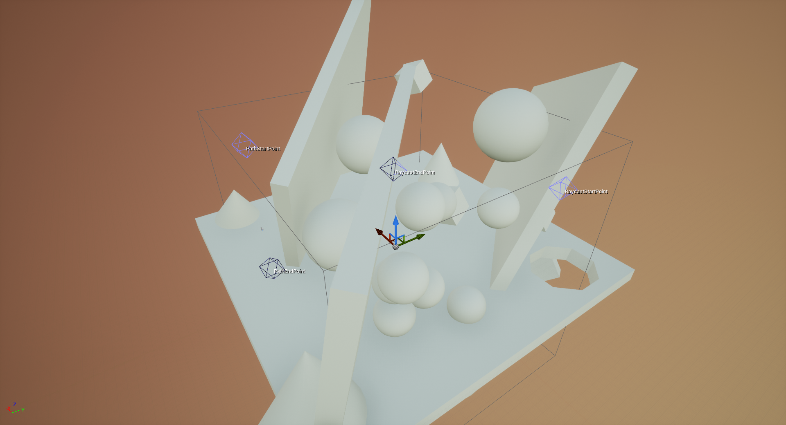
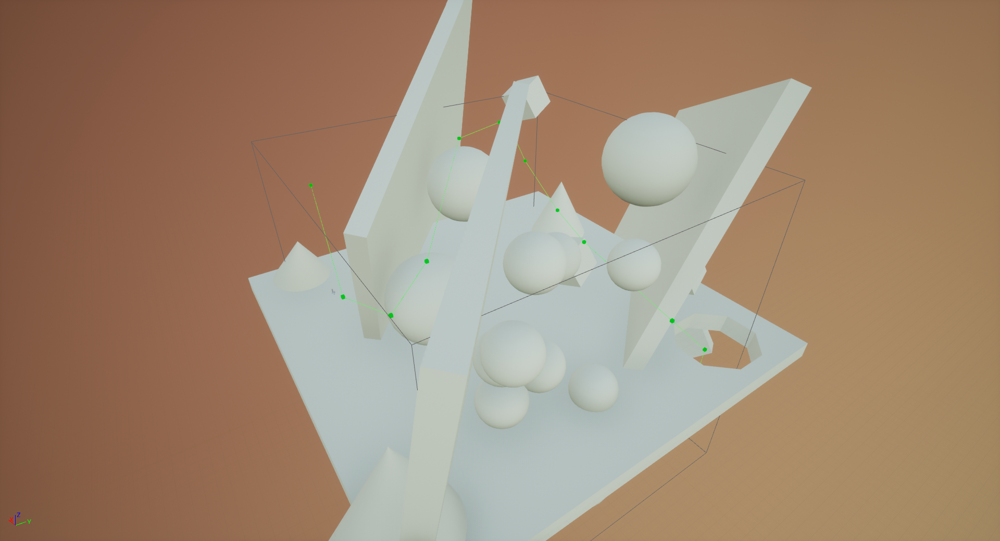
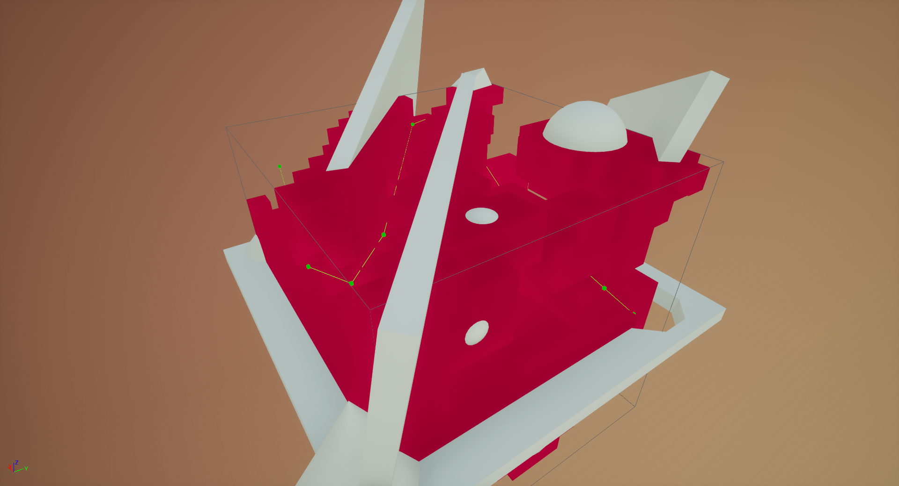

# Benchmarks

!!! warning "This page is more technical"

    This page is a deeper dive into the performance of the Flying Navigation System and is therefore fairly technical.
    However, understanding this page is not required for the functionality of the plugin.

<span id="preamble"></span>

## Preamble

These numbers were generated from the FlyingNavBenchmark project, available on [GitHub](https://github.com/BlenderSleuth/FlyingNavSystemSupport/tree/main/FlyingNavBenchmark).



#### Path Configuration



#### Theta\* Path Overview



#### Path with Octree Visualisation

All algorithms are CPU based, and were run on an Intel Core i7 4930K @ 3.9GHz in Windows
10. The project was packaged up in a Shipping build, so this should be running optimised
code.
The octree generation is multithreaded; the pathfinding and raycasting are
singlethreaded.
The tables are designed to illustrate the impact of the various optimisation options for
pathfinding.
Here we test the `HeuristicScale`, `Use Unit Cost` and `Use
Node Compensation` options, testing for A\*, Lazy Theta\* and Theta\* algorithms.
Details of these can be found in the [Usage](usage.md#pathfinding)
section.
I have also tested the octree raycast algorithm, and compared it to the standard Physics Line Trace.
I have used `Time (in milliseconds)`, `Number of Iterations` and
`Distance Proportion` to measure performance and accuracy. The pathfinding
algorithm explores one node per iteration.
The iterations for Theta\* and Lazy Theta\* take longer than A\* due to the line-of-sight check.
The distance proportion is a measure of how accurate the path is; these optimisation
options take shortcuts and therefore aren't guaranteed to find the shortest path.
The benchmark will compare the optimal path (Theta\* with no optimisation) to the found
path, calculating the value with the formula:

```cpp
int Distance = (FoundPathLength / OptimalPathLength) * 100%
```

It should be noted that the time column is not a useful measure for comparisons between
tables, as I could not get consistent results between runs.
I used `FPlatformTime::GetSeconds()` for benchmarking the runtime, which
calls
`QueryPerformanceCounter()` on Windows (which is apparently accurate), so I
don't know why the time fluctuates as it does.
You will notice this by the fact that fewer iterations does not necessarily mean smaller
runtime between tables, and theoretically the generation time should be identical.
Therefore, I will be using the Iterations counter to compare performance, and the time
column should only be used as an estimate.

<span id="path-benchmarks"></span>

## Pathfinding Benchmarks

#### Remarks

The test scene was designed to be a worst-case scenario for A\* style algorithms,
in which most of the search space would need to be explored to complete the path.
It should be noted that even on the lowest resolution, a perfectly acceptable path can be found for most flying agents,
so it really isn't necessary to crank up the number of layers as much as one might think.
With only `bUseUnitCost = true`, we see almost a halving in iterations across the board (around 1.6-1.7x better) with a consistent 10% increase in path distance for the any-angle algorithms.
It's 20-40% for A\*, but I believe this is because the extra steps in the path from the optimisation are not smoothed out by the line-of-sight check.
For the 4 layers case, this is pretty much the end of the story. No other optimisations improved on that score.
As the number of layers increase, the other optimisations come into play.
With `bUseNodeCompensation = true`, we get a similar improvement (1.7x) in the 9 layers case, but no improvement with 4 layers.
However, when using both options, we get a comfortable one third of the original number of iterations for 9 layers.
The middle layers fall proportionally between these examples.
Interestingly, the heuristic scale does not make much of a difference or even hinder the performance when both of these options are turned on,
but that could be due to the nature of the test scene.
The heuristic is not very useful for most of the path journey, but in real scenes in fairly open spaces the heuristic would come into its own.
Complicated mazes such as this don't have as much of a benefit from increasing the heuristic from 1.0.
As you can see, increasing the number of layers drastically increases the pathfinding and generation time.
You can get away with this by using asynchronous pathfinding, but this is not supported with behaviour trees at the moment.
Check out the [Usage](usage.md#pathfind-location) page for more information.
However, asynchronous processing is still using resources, so a larger max detail size is a better solution.

<span id="table1"></span>

#### No Optimisations

- `HeuristicScale = 1.0`
- `bUseUnitCost = false`
- `bUseNodeCompensation = false`

<table>
<tr>
<th rowspan="2"># Layers<a data-content="The number of layers in the octree. Adding a layer halves the voxel size, but increases eightfold the number of voxels" data-toggle="popover"></a></th>
<th rowspan="2"># Voxels<a data-content="If the volume was divided uniformly, the number of voxels the volume would contain" data-toggle="popover"></a></th>
<th rowspan="2">Generation
                                                Time (ms)<a data-content="Time in milliseconds to build octree from scratch" data-toggle="popover"></a></th>
<th colspan="3">A* <a data-content="The standard algorithm for pathfinding in games. Uses a distance heuristic to find the goal. Creates fixed angle paths." data-toggle="popover"></a></th>
<th colspan="3">Lazy Theta* <a data-content="A modification of Theta*, assumes line-of-sight between nodes and postpones raycast check until node is explored. Not as accurate but faster." data-toggle="popover"></a></th>
<th colspan="3">Theta* <a data-content="A modification of the A* algorithm, will attempt to skip nodes based on a fast line-of-sight check, allowing for any-angle paths." data-toggle="popover"></a></th>
</tr>
<tr>
<th>Time (ms)</th>
<th>Iterations</th>
<th>Distance</th>
<th>Time (ms)</th>
<th>Iterations</th>
<th>Distance</th>
<th>Time (ms)</th>
<th>Iterations</th>
<th>Distance</th>
</tr>
<tr>
<td>4</td>
<td>4,096</td>
<td>2.60</td>
<td>0.91</td>
<td>1,513</td>
<td>128%</td>
<td>1.75</td>
<td>1,516</td>
<td>102%</td>
<td>2.38</td>
<td>1,511</td>
<td>100%</td>
</tr>
<tr>
<td>5</td>
<td>32,768</td>
<td>8.10</td>
<td>9.28</td>
<td>13,203</td>
<td>121%</td>
<td>19.36</td>
<td>13,280</td>
<td>101%</td>
<td>32.54</td>
<td>13,272</td>
<td>100%</td>
</tr>
<tr>
<td>6</td>
<td>262,144</td>
<td>49.41</td>
<td>44.85</td>
<td>58,446</td>
<td>116%</td>
<td>109.21</td>
<td>58,433</td>
<td>100%</td>
<td>193.51</td>
<td>58,423</td>
<td>100%</td>
</tr>
<tr>
<td>7</td>
<td>2,097,152</td>
<td>262.82</td>
<td>171.30</td>
<td>205,002</td>
<td>113%</td>
<td>450.36</td>
<td>204,842</td>
<td>100%</td>
<td>847.54</td>
<td>204,925</td>
<td>100%</td>
</tr>
<tr>
<td>8</td>
<td>16,777,216</td>
<td>1102.86</td>
<td>834.48</td>
<td>901,969</td>
<td>112%</td>
<td>2810.56</td>
<td>901,100</td>
<td>100%</td>
<td>5557.71</td>
<td>902,426</td>
<td>100%</td>
</tr>
<tr>
<td>9</td>
<td>134,217,728</td>
<td>4369.69</td>
<td>4457.57</td>
<td>4,324,535</td>
<td>110%</td>
<td>21444.74</td>
<td>4,320,052</td>
<td>100%</td>
<td>47212.68</td>
<td>4,320,212</td>
<td>100%</td>
</tr>
</table>

---

<span id="table2"></span>

#### Unit Cost Nodes

- `HeuristicScale = 1.0`
- `bUseUnitCost = true`
- `bUseNodeCompensation = false`

<table>
<tr>
<th rowspan="2"># Layers</th>
<th rowspan="2"># Voxels</th>
<th rowspan="2">Generation Time (ms)
                                            </th>
<th colspan="3">A*</th>
<th colspan="3">Lazy Theta*</th>
<th colspan="3">Theta*</th>
</tr>
<tr>
<th>Time (ms)</th>
<th>Iterations</th>
<th>Distance</th>
<th>Time (ms)</th>
<th>Iterations</th>
<th>Distance</th>
<th>Time (ms)</th>
<th>Iterations</th>
<th>Distance</th>
</tr>
<tr>
<td>4</td>
<td>4,096</td>
<td>7.61</td>
<td>1.58</td>
<td> 911</td>
<td>151%</td>
<td>1.99</td>
<td> 910</td>
<td>112%</td>
<td>2.46</td>
<td> 910</td>
<td>111%</td>
</tr>
<tr>
<td>5</td>
<td>32,768</td>
<td>12.58</td>
<td>4.69</td>
<td>7,264</td>
<td>149%</td>
<td>9.87</td>
<td>7,232</td>
<td>109%</td>
<td>17.11</td>
<td>7,233</td>
<td>107%</td>
</tr>
<tr>
<td>6</td>
<td>262,144</td>
<td>56.29</td>
<td>18.29</td>
<td>33,058</td>
<td>157%</td>
<td>51.83</td>
<td>32,631</td>
<td>110%</td>
<td>101.95</td>
<td>32,637</td>
<td>110%</td>
</tr>
<tr>
<td>7</td>
<td>2,097,152</td>
<td>265.47</td>
<td>67.54</td>
<td>117,504</td>
<td>144%</td>
<td>233.23</td>
<td>116,125</td>
<td>110%</td>
<td>484</td>
<td>116,170</td>
<td>111%</td>
</tr>
<tr>
<td>8</td>
<td>16,777,216</td>
<td>1067.37</td>
<td>262.17</td>
<td>518,954</td>
<td>150%</td>
<td>1149.60</td>
<td>511,784</td>
<td>110%</td>
<td>2414.94</td>
<td>511,715</td>
<td>110%</td>
</tr>
<tr>
<td>9</td>
<td>134,217,728</td>
<td>4286.96</td>
<td>1502.63</td>
<td>2,491,289</td>
<td>149%</td>
<td>9890.55</td>
<td>2,452,118</td>
<td>108%</td>
<td>24578.45</td>
<td>2,452,855</td>
<td>109%</td>
</tr>
</table>

---

<span id="table3"></span>

#### Node Size Compensation

- `HeuristicScale = 1.0`
- `bUseUnitCost = false`
- `bUseNodeCompensation = true`

<table>
<tr>
<th rowspan="2"># Layers</th>
<th rowspan="2"># Voxels</th>
<th rowspan="2">Generation Time (ms)
                                            </th>
<th colspan="3">A*</th>
<th colspan="3">Lazy Theta*</th>
<th colspan="3">Theta*</th>
</tr>
<tr>
<th>Time (ms)</th>
<th>Iterations</th>
<th>Distance</th>
<th>Time (ms)</th>
<th>Iterations</th>
<th>Distance</th>
<th>Time (ms)</th>
<th>Iterations</th>
<th>Distance</th>
</tr>
<tr>
<td>4</td>
<td>4,096</td>
<td>7.45</td>
<td>2.09</td>
<td>1,513</td>
<td>128%</td>
<td>2.93</td>
<td>1,516</td>
<td>102%</td>
<td>3.53</td>
<td>1,511</td>
<td>100%</td>
</tr>
<tr>
<td>5</td>
<td>32,768</td>
<td>11.52</td>
<td>10.47</td>
<td>13,225</td>
<td>121%</td>
<td>20.70</td>
<td>13,280</td>
<td>101%</td>
<td>33.54</td>
<td>13,273</td>
<td>100%</td>
</tr>
<tr>
<td>6</td>
<td>262,144</td>
<td>57.99</td>
<td>44.55</td>
<td>56,673</td>
<td>130%</td>
<td>105.42</td>
<td>57,065</td>
<td>108%</td>
<td>188.83</td>
<td>56,907</td>
<td>107%</td>
</tr>
<tr>
<td>7</td>
<td>2,097,152</td>
<td>261.01</td>
<td>159.37</td>
<td>184,989</td>
<td>129%</td>
<td>384.13</td>
<td>174,653</td>
<td>117%</td>
<td>714.12</td>
<td>170,859</td>
<td>115%</td>
</tr>
<tr>
<td>8</td>
<td>16,777,216</td>
<td>1099.90</td>
<td>500.27</td>
<td>660,749</td>
<td>162%</td>
<td>1332.56</td>
<td>563,422</td>
<td>121%</td>
<td>2598.52</td>
<td>616,339</td>
<td>125%</td>
</tr>
<tr>
<td>9</td>
<td>134,217,728</td>
<td>4275.72</td>
<td>2877.39</td>
<td>2,542,330</td>
<td>146%</td>
<td>12377.01</td>
<td>2,595,133</td>
<td>124%</td>
<td>26376.67</td>
<td>2,616,811</td>
<td>124%</td>
</tr>
</table>

---

<span id="table4"></span>

#### Unit Cost Nodes and Node Size Compensation

- `HeuristicScale = 1.0`
- `bUseUnitCost = true`
- `bUseNodeCompensation = true`

<table>
<tr>
<th rowspan="2"># Layers</th>
<th rowspan="2"># Voxels</th>
<th rowspan="2">Generation Time (ms)
                                            </th>
<th colspan="3">A*</th>
<th colspan="3">Lazy Theta*</th>
<th colspan="3">Theta*</th>
</tr>
<tr>
<th>Time (ms)</th>
<th>Iterations</th>
<th>Distance</th>
<th>Time (ms)</th>
<th>Iterations</th>
<th>Distance</th>
<th>Time (ms)</th>
<th>Iterations</th>
<th>Distance</th>
</tr>
<tr>
<td>4</td>
<td>4,096</td>
<td>7.49</td>
<td>1.61</td>
<td> 911</td>
<td>151%</td>
<td>2.00</td>
<td> 910</td>
<td>112%</td>
<td>2.47</td>
<td> 910</td>
<td>111%</td>
</tr>
<tr>
<td>5</td>
<td>32,768</td>
<td>11.64</td>
<td>4.77</td>
<td>7,257</td>
<td>153%</td>
<td>9.97</td>
<td>7,228</td>
<td>107%</td>
<td>17.28</td>
<td>7,229</td>
<td>106%</td>
</tr>
<tr>
<td>6</td>
<td>262,144</td>
<td>53.11</td>
<td>19.00</td>
<td>33,000</td>
<td>176%</td>
<td>50.07</td>
<td>32,640</td>
<td>110%</td>
<td>96.89</td>
<td>32,647</td>
<td>110%</td>
</tr>
<tr>
<td>7</td>
<td>2,097,152</td>
<td>272.20</td>
<td>64.68</td>
<td>103,017</td>
<td>170%</td>
<td>185.21</td>
<td>103,698</td>
<td>121%</td>
<td>354.72</td>
<td>103,717</td>
<td>121%</td>
</tr>
<tr>
<td>8</td>
<td>16,777,216</td>
<td>1267.24</td>
<td>271.63</td>
<td>360,523</td>
<td>184%</td>
<td>727.31</td>
<td>365,728</td>
<td>127%</td>
<td>1336.97</td>
<td>365,720</td>
<td>127%</td>
</tr>
<tr>
<td>9</td>
<td>134,217,728</td>
<td>4266.87</td>
<td>1057.10</td>
<td>1,417,913</td>
<td>182%</td>
<td>2794.43</td>
<td>1,426,194</td>
<td>128%</td>
<td>6686.54</td>
<td>1,426,159</td>
<td>128%</td>
</tr>
</table>

---

<span id="table5"></span>

#### 5x Heuristic Weighting

- `HeuristicScale = 5.0`
- `bUseUnitCost = false`
- `bUseNodeCompensation = false`

<table>
<tr>
<th rowspan="2"># Layers</th>
<th rowspan="2"># Voxels</th>
<th rowspan="2">Generation Time (ms)
                                            </th>
<th colspan="3">A*</th>
<th colspan="3">Lazy Theta*</th>
<th colspan="3">Theta*</th>
</tr>
<tr>
<th>Time (ms)</th>
<th>Iterations</th>
<th>Distance</th>
<th>Time (ms)</th>
<th>Iterations</th>
<th>Distance</th>
<th>Time (ms)</th>
<th>Iterations</th>
<th>Distance</th>
</tr>
<tr>
<td>4</td>
<td>4,096</td>
<td>7.83</td>
<td>1.90</td>
<td>1,108</td>
<td>135%</td>
<td>2.34</td>
<td>1,022</td>
<td>102%</td>
<td>2.80</td>
<td>1,015</td>
<td>101%</td>
</tr>
<tr>
<td>5</td>
<td>32,768</td>
<td>11.89</td>
<td>6.81</td>
<td>7,949</td>
<td>132%</td>
<td>12.21</td>
<td>7,806</td>
<td>105%</td>
<td>19.49</td>
<td>7,816</td>
<td>104%</td>
</tr>
<tr>
<td>6</td>
<td>262,144</td>
<td>53.04</td>
<td>27.24</td>
<td>34,801</td>
<td>128%</td>
<td>61.31</td>
<td>34,686</td>
<td>105%</td>
<td>110.82</td>
<td>34,804</td>
<td>105%</td>
</tr>
<tr>
<td>7</td>
<td>2,097,152</td>
<td>259.69</td>
<td>100.97</td>
<td>124,194</td>
<td>124%</td>
<td>251.58</td>
<td>124,056</td>
<td>105%</td>
<td>481.21</td>
<td>124,030</td>
<td>104%</td>
</tr>
<tr>
<td>8</td>
<td>16,777,216</td>
<td>1064.77</td>
<td>368.79</td>
<td>542,751</td>
<td>123%</td>
<td>1179.15</td>
<td>542,808</td>
<td>104%</td>
<td>2324.22</td>
<td>542,652</td>
<td>104%</td>
</tr>
<tr>
<td>9</td>
<td>134,217,728</td>
<td>4358.30</td>
<td>2027.02</td>
<td>2,578,450</td>
<td>123%</td>
<td>8731.57</td>
<td>2,580,471</td>
<td>104%</td>
<td>23427.42</td>
<td>2,579,942</td>
<td>104%</td>
</tr>
</table>

---

<span id="table6"></span>

#### 10x Heuristic Weighting

- `HeuristicScale = 10.0`
- `bUseUnitCost = false`
- `bUseNodeCompensation = false`

<table>
<tr>
<th rowspan="2"># Layers</th>
<th rowspan="2"># Voxels</th>
<th rowspan="2">Generation Time (ms)
                                            </th>
<th colspan="3">A*</th>
<th colspan="3">Lazy Theta*</th>
<th colspan="3">Theta*</th>
</tr>
<tr>
<th>Time (ms)</th>
<th>Iterations</th>
<th>Distance</th>
<th>Time (ms)</th>
<th>Iterations</th>
<th>Distance</th>
<th>Time (ms)</th>
<th>Iterations</th>
<th>Distance</th>
</tr>
<tr>
<td>4</td>
<td>4,096</td>
<td>7.53</td>
<td>1.80</td>
<td> 975</td>
<td>135%</td>
<td>2.26</td>
<td> 956</td>
<td>107%</td>
<td>2.71</td>
<td> 950</td>
<td>107%</td>
</tr>
<tr>
<td>5</td>
<td>32,768</td>
<td>11.83</td>
<td>6.48</td>
<td>7,500</td>
<td>137%</td>
<td>11.75</td>
<td>7,487</td>
<td>105%</td>
<td>18.46</td>
<td>7,472</td>
<td>105%</td>
</tr>
<tr>
<td>6</td>
<td>262,144</td>
<td>54.94</td>
<td>26.42</td>
<td>33,543</td>
<td>132%</td>
<td>58.88</td>
<td>33,605</td>
<td>104%</td>
<td>105.72</td>
<td>33,633</td>
<td>104%</td>
</tr>
<tr>
<td>7</td>
<td>2,097,152</td>
<td>266.61</td>
<td>97.34</td>
<td>119,126</td>
<td>126%</td>
<td>257.39</td>
<td>120,044</td>
<td>105%</td>
<td>473.18</td>
<td>119,945</td>
<td>105%</td>
</tr>
<tr>
<td>8</td>
<td>16,777,216</td>
<td>1062.95</td>
<td>361.79</td>
<td>525,988</td>
<td>132%</td>
<td>1161.01</td>
<td>528,216</td>
<td>106%</td>
<td>2221.15</td>
<td>527,191</td>
<td>105%</td>
</tr>
<tr>
<td>9</td>
<td>134,217,728</td>
<td>4312.08</td>
<td>2501.81</td>
<td>2,491,091</td>
<td>129%</td>
<td>11184.10</td>
<td>2,502,519</td>
<td>103%</td>
<td>23961.32</td>
<td>2,510,228</td>
<td>103%</td>
</tr>
</table>

---

<span id="table7"></span>

#### 50x Heuristic Weighting

- `HeuristicScale = 50.0`
- `bUseUnitCost = false`
- `bUseNodeCompensation = false`

<table>
<tr>
<th rowspan="2"># Layers</th>
<th rowspan="2"># Voxels</th>
<th rowspan="2">Generation Time (ms)
                                            </th>
<th colspan="3">A*</th>
<th colspan="3">Lazy Theta*</th>
<th colspan="3">Theta*</th>
</tr>
<tr>
<th>Time (ms)</th>
<th>Iterations</th>
<th>Distance</th>
<th>Time (ms)</th>
<th>Iterations</th>
<th>Distance</th>
<th>Time (ms)</th>
<th>Iterations</th>
<th>Distance</th>
</tr>
<tr>
<td>4</td>
<td>4,096</td>
<td>7.41</td>
<td>1.73</td>
<td> 918</td>
<td>142%</td>
<td>2.19</td>
<td> 912</td>
<td>109%</td>
<td>2.60</td>
<td> 913</td>
<td>109%</td>
</tr>
<tr>
<td>5</td>
<td>32,768</td>
<td>10.41</td>
<td>6.37</td>
<td>7,273</td>
<td>149%</td>
<td>11.53</td>
<td>7,296</td>
<td>108%</td>
<td>18.22</td>
<td>7,294</td>
<td>107%</td>
</tr>
<tr>
<td>6</td>
<td>262,144</td>
<td>56.18</td>
<td>26.10</td>
<td>33,040</td>
<td>155%</td>
<td>59.41</td>
<td>32,857</td>
<td>110%</td>
<td>107.89</td>
<td>32,855</td>
<td>110%</td>
</tr>
<tr>
<td>7</td>
<td>2,097,152</td>
<td>264.17</td>
<td>96.50</td>
<td>117,471</td>
<td>146%</td>
<td>257.28</td>
<td>117,047</td>
<td>109%</td>
<td>496.25</td>
<td>117,040</td>
<td>109%</td>
</tr>
<tr>
<td>8</td>
<td>16,777,216</td>
<td>1257.29</td>
<td>453.45</td>
<td>516,538</td>
<td>146%</td>
<td>1568.65</td>
<td>515,013</td>
<td>108%</td>
<td>3205.76</td>
<td>515,040</td>
<td>108%</td>
</tr>
<tr>
<td>9</td>
<td>134,217,728</td>
<td>4346.97</td>
<td>2513.02</td>
<td>2,470,447</td>
<td>144%</td>
<td>10895.58</td>
<td>2,463,656</td>
<td>106%</td>
<td>23037.96</td>
<td>2,464,780</td>
<td>106%</td>
</tr>
</table>

---

<span id="table8"></span>

#### 10x Heuristic Weighting and Unit Cost Nodes

- `HeuristicScale = 1.0`
- `bUseUnitCost = true`
- `bUseNodeCompensation = false`

<table>
<tr>
<th rowspan="2"># Layers</th>
<th rowspan="2"># Voxels</th>
<th rowspan="2">Generation Time (ms)</th>
<th colspan="3">A*</th>
<th colspan="3">Lazy Theta*</th>
<th colspan="3">Theta*</th>
</tr>
<tr>
<th>Time (ms)</th>
<th>Iterations</th>
<th>Distance</th>
<th>Time (ms)</th>
<th>Iterations</th>
<th>Distance</th>
<th>Time (ms)</th>
<th>Iterations</th>
<th>Distance</th>
</tr>
<tr>
<td>4</td>
<td>4,096</td>
<td>8.27</td>
<td>1.56</td>
<td> 910 </td>
<td>151%</td>
<td>1.98</td>
<td> 910 </td>
<td>112%</td>
<td>2.41</td>
<td> 910 </td>
<td>111%</td>
</tr>
<tr>
<td>5</td>
<td>32,768</td>
<td>18.26</td>
<td>4.64</td>
<td>7,230</td>
<td>149%</td>
<td>9.86</td>
<td>7,231</td>
<td>109%</td>
<td>17.14</td>
<td>7,231</td>
<td>107%</td>
</tr>
<tr>
<td>6</td>
<td>262,144</td>
<td>51.81</td>
<td>18.01</td>
<td>32,666</td>
<td>163%</td>
<td>51.85</td>
<td>32,598</td>
<td>110%</td>
<td>102.05</td>
<td>32,598</td>
<td>110%</td>
</tr>
<tr>
<td>7</td>
<td>2,097,152</td>
<td>253.45</td>
<td>66.90</td>
<td>116,275</td>
<td>167%</td>
<td>229.97</td>
<td>116,007</td>
<td>110%</td>
<td>467.92</td>
<td>116,012</td>
<td>111%</td>
</tr>
<tr>
<td>8</td>
<td>16,777,216</td>
<td>1078.94</td>
<td>258.58</td>
<td>513,264</td>
<td>165%</td>
<td>1131.15</td>
<td>511,406</td>
<td>108%</td>
<td>3015.29</td>
<td>511,399</td>
<td>108%</td>
</tr>
<tr>
<td>9</td>
<td>134,217,728</td>
<td>4288.11</td>
<td>1853.16</td>
<td>2,459,858</td>
<td>157%</td>
<td>10238.10</td>
<td>2,449,716</td>
<td>105%</td>
<td>23367.65</td>
<td>2,449,716</td>
<td>105%</td>
</tr>
</table>

---

<span id="table9"></span>

#### 10x Heuristic Weighting and Node Size Compensation

- `HeuristicScale = 10.0`
- `bUseUnitCost = false`
- `bUseNodeCompensation = true`

<table>
<tr>
<th rowspan="2"># Layers</th>
<th rowspan="2"># Voxels</th>
<th rowspan="2">Generation Time (ms)</th>
<th colspan="3">A*</th>
<th colspan="3">Lazy Theta*</th>
<th colspan="3">Theta*</th>
</tr>
<tr>
<th>Time (ms)</th>
<th>Iterations</th>
<th>Distance</th>
<th>Time (ms)</th>
<th>Iterations</th>
<th>Distance</th>
<th>Time (ms)</th>
<th>Iterations</th>
<th>Distance</th>
</tr>
<tr>
<td>4</td>
<td>4,096</td>
<td>7.34</td>
<td>1.79</td>
<td> 975 </td>
<td>135%</td>
<td>2.26</td>
<td> 956 </td>
<td>107%</td>
<td>2.62</td>
<td> 950 </td>
<td>107%</td>
</tr>
<tr>
<td>5</td>
<td>32,768</td>
<td>11.39</td>
<td>6.57</td>
<td>7,499</td>
<td>138%</td>
<td>11.83</td>
<td>7,484</td>
<td>105%</td>
<td>18.56</td>
<td>7,466</td>
<td>104%</td>
</tr>
<tr>
<td>6</td>
<td>262,144</td>
<td>61.60</td>
<td>27.53</td>
<td>33,776</td>
<td>134%</td>
<td>60.05</td>
<td>33,610</td>
<td>104%</td>
<td>107.44</td>
<td>33,641</td>
<td>104%</td>
</tr>
<tr>
<td>7</td>
<td>2,097,152</td>
<td>267.13</td>
<td>90.43</td>
<td>101,188</td>
<td>173%</td>
<td>224.94</td>
<td>99,847</td>
<td>121%</td>
<td>433.79</td>
<td>100,202</td>
<td>117%</td>
</tr>
<tr>
<td>8</td>
<td>16,777,216</td>
<td>1098.10</td>
<td>278.71</td>
<td>355,838</td>
<td>187%</td>
<td>721.82</td>
<td>361,459</td>
<td>130%</td>
<td>1327.04</td>
<td>363,007</td>
<td>126%</td>
</tr>
<tr>
<td>9</td>
<td>134,217,728</td>
<td>4279.99</td>
<td>1390.06</td>
<td>1,491,350</td>
<td>187%</td>
<td>5642.72</td>
<td>1,501,437</td>
<td>130%</td>
<td>11290.54</td>
<td>1,500,582</td>
<td>127%</td>
</tr>
</table>

---

<span id="table10"></span>

#### 10x Heuristic Weighting, Unit Cost Nodes and Node Size Compensation

- `HeuristicScale = 10.0`
- `bUseUnitCost = true`
- `bUseNodeCompensation = true`

<table>
<tr>
<th rowspan="2"># Layers</th>
<th rowspan="2"># Voxels</th>
<th rowspan="2">Generation Time (ms)</th>
<th colspan="3">A*</th>
<th colspan="3">Lazy Theta*</th>
<th colspan="3">Theta*</th>
</tr>
<tr>
<th>Time (ms)</th>
<th>Iterations</th>
<th>Distance</th>
<th>Time (ms)</th>
<th>Iterations</th>
<th>Distance</th>
<th>Time (ms)</th>
<th>Iterations</th>
<th>Distance</th>
</tr>
<tr>
<td>4</td>
<td>4,096</td>
<td>8.06</td>
<td>1.83</td>
<td> 910 </td>
<td>151%</td>
<td>2.06</td>
<td> 910 </td>
<td>112%</td>
<td>2.44</td>
<td> 910 </td>
<td>111%</td>
</tr>
<tr>
<td>5</td>
<td>32,768</td>
<td>10.34</td>
<td>4.74</td>
<td>7,228</td>
<td>153%</td>
<td>9.94</td>
<td>7,229</td>
<td>107%</td>
<td>17.54</td>
<td>7,229</td>
<td>106%</td>
</tr>
<tr>
<td>6</td>
<td>262,144</td>
<td>52.26</td>
<td>18.81</td>
<td>32,670</td>
<td>166%</td>
<td>50.90</td>
<td>32,603</td>
<td>110%</td>
<td>96.54</td>
<td>32,604</td>
<td>110%</td>
</tr>
<tr>
<td>7</td>
<td>2,097,152</td>
<td>257.24</td>
<td>65.39</td>
<td>103,680</td>
<td>177%</td>
<td>181.03</td>
<td>103,781</td>
<td>121%</td>
<td>352.56</td>
<td>103,781</td>
<td>121%</td>
</tr>
<tr>
<td>8</td>
<td>16,777,216</td>
<td>1092.49</td>
<td>218.64</td>
<td>365,329</td>
<td>181%</td>
<td>565.96</td>
<td>365,942</td>
<td>127%</td>
<td>1054.23</td>
<td>365,940</td>
<td>127%</td>
</tr>
<tr>
<td>9</td>
<td>134,217,728</td>
<td>4294.01</td>
<td>1344.35</td>
<td>1,425,086</td>
<td>181%</td>
<td>3600.87</td>
<td>1,426,346</td>
<td>128%</td>
<td>6796.15</td>
<td>1,426,343</td>
<td>128%</td>
</tr>
</table>

<span id="raycast-benchmarks"></span>

## Raycast Benchmarks

#### Remarks

The Physics Line Trace obviously doesn't depend on the octree while the raycasting does.
The octree raycast is used for the line-of-sight checks in the pathfinding algorithm.
I wasn't able to get the raycast time to increase as expected with the layer count, so everything past 5 layers is within the margin of error.
It's clear that the algorithm is very efficient, consistently being 3x faster than a physics line trace.
It should be noted however that both are very fast and that the Physics Line Trace is more flexible.

<span id="table11"></span>

| # Layers | # Voxels | Generation Time (ms) | Octree Raycast Time (μs) | Physics Line Trace Time (μs) |
| --- | --- | --- | --- | --- |
| 4 | 4,096 | 7.45 | 0.20 | 2.05 |
| 5 | 32,768 | 11.52 | 0.68 | 2.04 |
| 6 | 262,144 | 57.99 | 0.70 | 2.15 |
| 7 | 2,097,152 | 261.01 | 0.64 | 2.02 |
| 8 | 16,777,216 | 1099.9 | 0.57 | 1.63 |
| 9 | 134,217,728 | 4275.72 | 0.77 | 2.16 |
