# Quick Start

<span id="download-section"></span>

## Download

The Flying Navigation System plugin can be found on the Unreal Engine Marketplace. It can be downloaded and installed from the Library tab of the Epic Games Launcher.

 [Download the Flying Navigation System](https://www.unrealengine.com/marketplace/en-US/product/65b9b3247c5c458dbb6de81c79cdc8f0)

<span id="quickstart-section"></span>

## Quickstart Guide

In order for 3D pathfinding to work, an octree needs to be created in the level.
It is used by the pathfinding algorithm to navigate around obstacles.

### Part 1: Creating the Octree

<span id="step1"></span>

##### Step 1

Once the plugin is downloaded to your engine version, create a Flying template project.

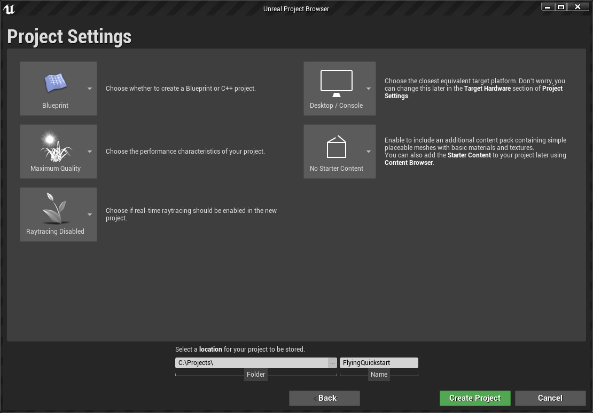

Make sure to enable the plugin (Under `Navigation`) in the Plugins window and restart the editor.

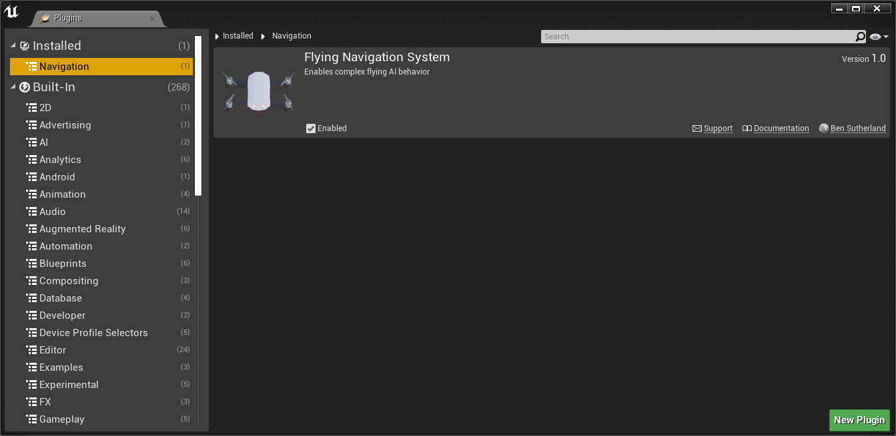

<span id="step2"></span>

##### Step 2

Head over to Project Settings, then `Engine/Navigation System`.
Now we want to create at least one Navigation Agent.
Here two have been created, one that uses the Flying Navigation System and another that uses the standard Recast Navmesh system. Which system the agent uses is dependent on the `Preferred Nav Data` property.

1. Set an Agent to `FlyingNavigationData` to make it use the Flying Navigation System
2. Set an Agent to `RecastNavMesh` to make it use the default UE4 navigation.

You can also change the colour to distinguish the two, which is reflected in the debug display. For this quickstart, we won’t use the Recast agent.

!!! warning "IMPORTANT"

    Also make sure to set the `Navigation/Default Agent Name` to a valid name or None. Pathfinding requests will sometimes fail if an invalid name is set.

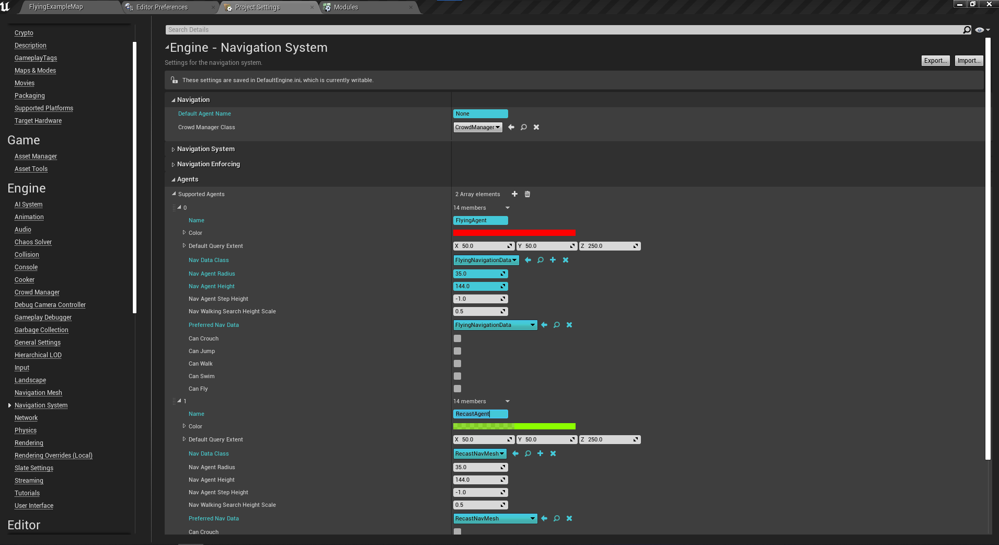

!!! info "`Nav Data Class` vs `Preferred Nav Data`"

    The `Nav Data Class` property is legacy, but setting it will automatically set `Preferred Nav Data` to the same value. The pathfinding method is only determined by `Preferred Nav Data`.

You should also note the `Nav Agent Radius` property, as this will become useful later.

<span id="step3"></span>

##### Step 3

Once the Supported Agents are set up, you can add a standard Nav Mesh Bounds Volume from the side panel.

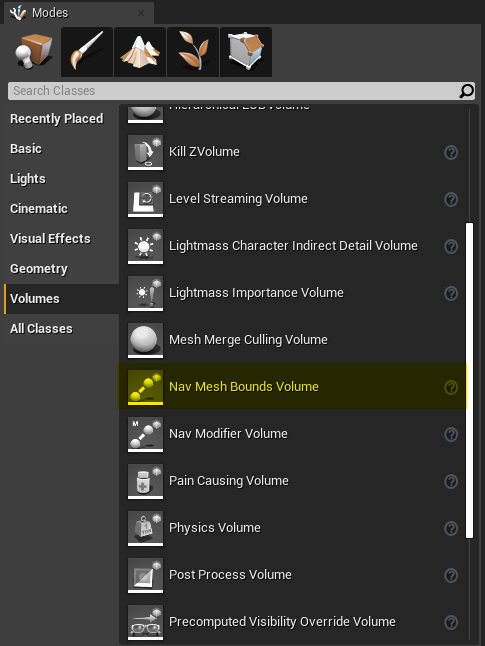

At this point you should see a `FlyingNavigationData-FlyingAgent` or similar actor spawned in your level.
If you also created a Recast agent you should also see a `RecastNavMesh-RecastAgent` or similar actor.

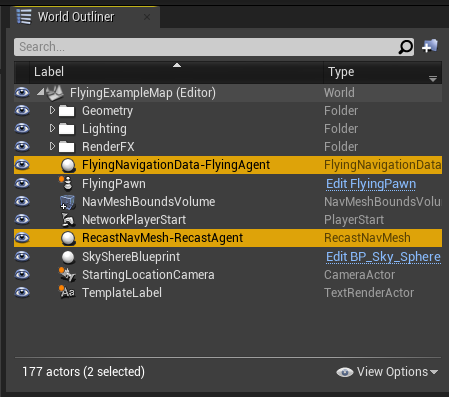

!!! warning "If you can't find it:"

    You may be required to reload the level after placing the bounds volume to trigger the Navigation Actor spawn.
    If you still don’t see the actor, make sure that `FlyingAgent` is checked under `WorldSettings/World/NavigationSystemConfig/SupportedAgentsMask` and `NavMeshBoundsVolume/Navigation/SupportedAgents`.

<span id="step4"></span>

##### Step 4

You can now scale the bounds volume to fit your scene. For the FlyingExampleMap, that looks like this:

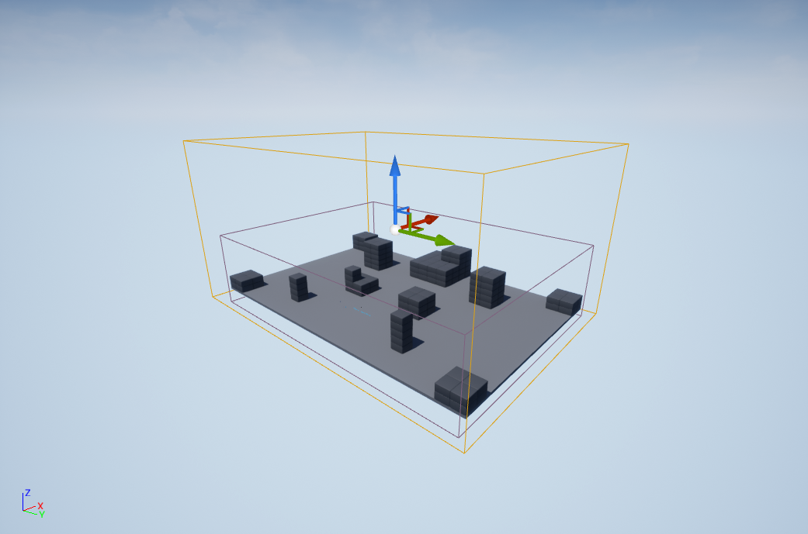

!!! info "Generating Octrees in Levels"

    The Flying Navigation System will generate one Octree structure in the world, which is required to be a cube.
    This cube is calculated from the *largest edge* of the *sum* of the Nav Mesh Bounds Volumes. (The sum of boxes is a larger box that encapsulates both).
    However, the building algorithm only takes meshes into account that are inside Nav Mesh Bounds Volumes (as well as some other optimisations).
    The Octree cube centre is calculated from the *centre* of the *sum* of the Nav Mesh Bounds Volumes, so it can be useful to scale up and move the volume to make the best use of the flying space.

<span id="step5"></span>

##### Step 5

Select the FlyingNavigationData actor, and click `Rebuild Navigation Data` (Or click `Build/Build Paths` in the toolbar).
Make sure `Enable Drawing` and `Show/Navigation` in the viewport (press `P`) are both checked, and you should get something like this:

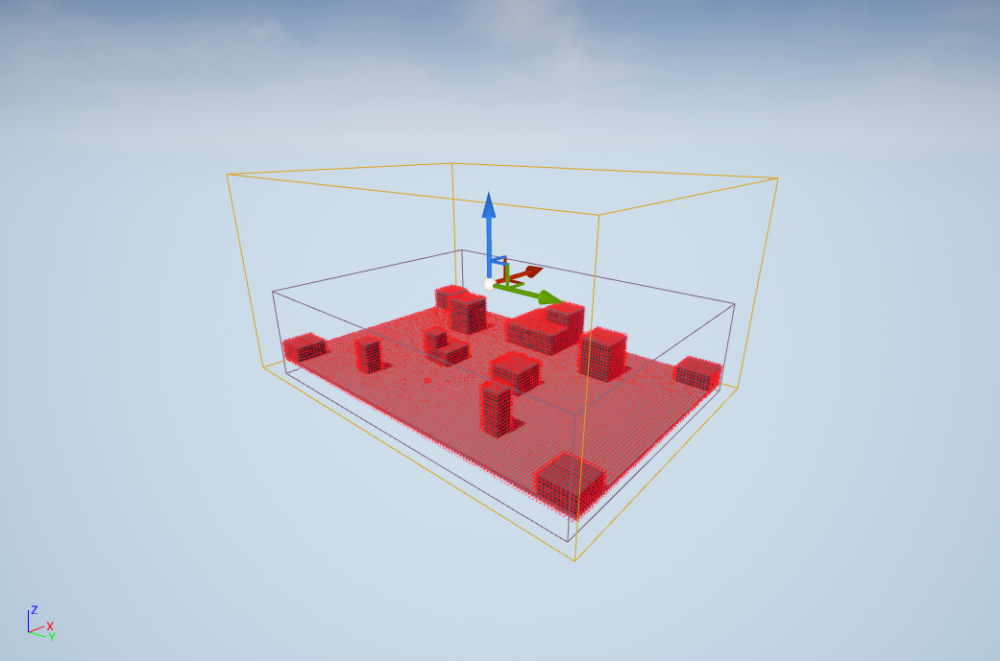

<span id="step6"></span>

##### Step 6

We’re not quite finished yet: you might notice that the player spaceship is being treated as a blocking mesh.
This will be problematic for the pathfinding, as the destination point (the spaceship) will be inside a blocked area.

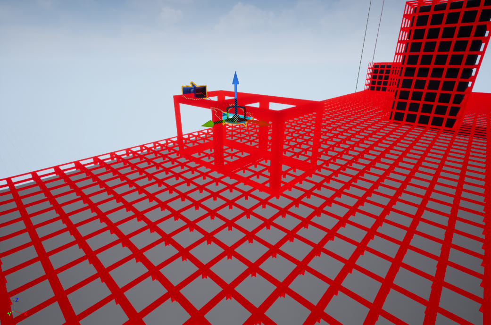

To fix this, disable `Collision/Can Ever Affect Navigation` on the Flying Pawn's mesh:

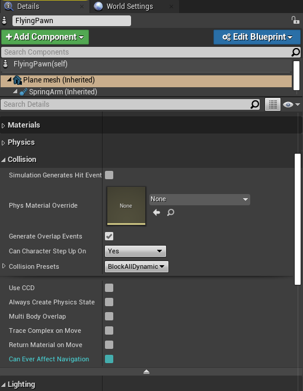

Rebuild the Octree, and everything should be good to go.

!!! success "Congratulations!"

    You’ve set up your first octree!

### Part 2: Building a flying AI

This is a basic UE4 AI setup; there are lots of AI programming tutorials on YouTube, such as [this](https://youtu.be/zNJEvAGiw7w) one. Our AI will follow the player wherever they go.

<span id="step7"></span>

##### Step 7

Create a new `AIController` Blueprint (you'll need to search for it under `All Classes`) called `AIC_FollowingController`.
Create a new Blackboard asset (`Right Click -> Artificial Intelligence`) called `BB_FollowingPawn`.
Create a new `Pawn` Blueprint called `BP_FollowingPawn`.
Create a new Behavior Tree asset (`Right Click -> Artificial Intelligence`) called `BT_FollowingBehavior`.

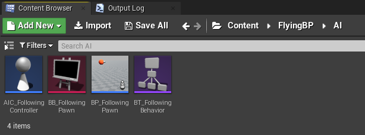

Add a few static mesh components to the BP\_FollowingPawn to make it look interesting.
Make sure to disable `Collision/Can Ever Affect Navigation` on each mesh.

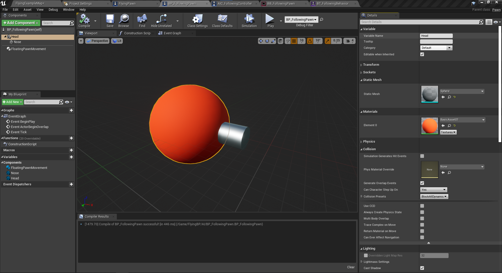

<span id="step8"></span>

##### Step 8

Add a `FloatingPawnMovement` component.
All pawns require some kind of movement component to participate in navigation. This could be the `CharacterMovementComponent` in the Character class.
The movement component settings (`Nav Movement/Movement Capabilities`) define which navigation system your agent should use:

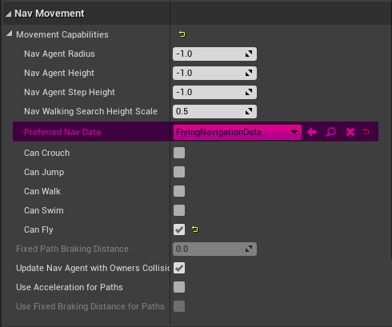

!!! info "`Can Crouch` etc. checkboxes"

    The `Can Crouch`, `Can Walk`, `Can Fly` etc. checkboxes are only used by `CharacterMovementComponent` and will not impact how this pawn behaves.
    However, the other options are used for determining which navigation data to use if you have set up multiple agents with the same `Preferred Nav Data` in Project Settings.
    Please see [here](usage.md#FNavAgentProperties) for more info.

<span id="step9"></span>

##### Step 9

Add a `TargetActor` Object value to the blackboard, with `Actor` as the `Base Class`.

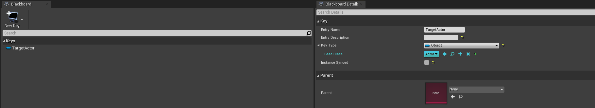

In `AIC_FollowingController`, set up the blackboard, set the `TargetActor` property and run the behavior tree in the `BeginPlay` event.
To set the player pawn to `TargetActor`, use the `Set Value as Object` node with a string literal in the key name (in this case `TargetActor`).

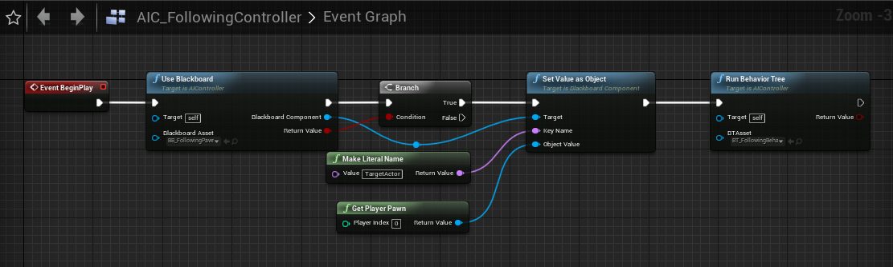

Blueprint Code

```text
Begin Object Class=/Script/BlueprintGraph.K2Node_CallFunction Name="K2Node_CallFunction_0"
   FunctionReference=(MemberName="UseBlackboard",bSelfContext=True)
   NodePosX=208
   NodePosY=-16
   NodeGuid=3E8252FF45537C625491F2AB9495ED10
   CustomProperties Pin (PinId=80F9E3BA4926DA5335D705ADCE98485F,PinName="execute",PinType.PinCategory="exec",PinType.PinSubCategory="",PinType.PinSubCategoryObject=None,PinType.PinSubCategoryMemberReference=(),PinType.PinValueType=(),PinType.ContainerType=None,PinType.bIsReference=False,PinType.bIsConst=False,PinType.bIsWeakPointer=False,LinkedTo=(K2Node_Event_0 07684E254FC1C1BEF80CE894942660B6,),PersistentGuid=00000000000000000000000000000000,bHidden=False,bNotConnectable=False,bDefaultValueIsReadOnly=False,bDefaultValueIsIgnored=False,bAdvancedView=False,bOrphanedPin=False,)
   CustomProperties Pin (PinId=11A0F87E40F44FEED746ABAD9532C2F5,PinName="then",Direction="EGPD_Output",PinType.PinCategory="exec",PinType.PinSubCategory="",PinType.PinSubCategoryObject=None,PinType.PinSubCategoryMemberReference=(),PinType.PinValueType=(),PinType.ContainerType=None,PinType.bIsReference=False,PinType.bIsConst=False,PinType.bIsWeakPointer=False,LinkedTo=(K2Node_IfThenElse_0 67B370EF4988E230B080CBA8A29ADE51,),PersistentGuid=00000000000000000000000000000000,bHidden=False,bNotConnectable=False,bDefaultValueIsReadOnly=False,bDefaultValueIsIgnored=False,bAdvancedView=False,bOrphanedPin=False,)
   CustomProperties Pin (PinId=4285BE6D42F0420F65B66496DAA3C7CA,PinName="self",PinFriendlyName=NSLOCTEXT("K2Node", "Target", "Target"),PinType.PinCategory="object",PinType.PinSubCategory="",PinType.PinSubCategoryObject=Class'"/Script/AIModule.AIController"',PinType.PinSubCategoryMemberReference=(),PinType.PinValueType=(),PinType.ContainerType=None,PinType.bIsReference=False,PinType.bIsConst=False,PinType.bIsWeakPointer=False,PersistentGuid=00000000000000000000000000000000,bHidden=False,bNotConnectable=False,bDefaultValueIsReadOnly=False,bDefaultValueIsIgnored=False,bAdvancedView=False,bOrphanedPin=False,)
   CustomProperties Pin (PinId=3F6D3995430BDFDF084D03AEAC66B8E5,PinName="BlackboardAsset",PinType.PinCategory="object",PinType.PinSubCategory="",PinType.PinSubCategoryObject=Class'"/Script/AIModule.BlackboardData"',PinType.PinSubCategoryMemberReference=(),PinType.PinValueType=(),PinType.ContainerType=None,PinType.bIsReference=False,PinType.bIsConst=False,PinType.bIsWeakPointer=False,DefaultObject="/Game/FlyingBP/AI/BB_FollowingPawn.BB_FollowingPawn",PersistentGuid=00000000000000000000000000000000,bHidden=False,bNotConnectable=False,bDefaultValueIsReadOnly=False,bDefaultValueIsIgnored=False,bAdvancedView=False,bOrphanedPin=False,)
   CustomProperties Pin (PinId=ED5D29C64055856BFFC07CB6A5366A91,PinName="BlackboardComponent",Direction="EGPD_Output",PinType.PinCategory="object",PinType.PinSubCategory="",PinType.PinSubCategoryObject=Class'"/Script/AIModule.BlackboardComponent"',PinType.PinSubCategoryMemberReference=(),PinType.PinValueType=(),PinType.ContainerType=None,PinType.bIsReference=False,PinType.bIsConst=False,PinType.bIsWeakPointer=False,LinkedTo=(K2Node_Knot_0 3DB90C9D4381803596FD83A2E4B68526,),PersistentGuid=00000000000000000000000000000000,bHidden=False,bNotConnectable=False,bDefaultValueIsReadOnly=False,bDefaultValueIsIgnored=False,bAdvancedView=False,bOrphanedPin=False,)
   CustomProperties Pin (PinId=205905FA4C924368079A088C7F61A431,PinName="ReturnValue",Direction="EGPD_Output",PinType.PinCategory="bool",PinType.PinSubCategory="",PinType.PinSubCategoryObject=None,PinType.PinSubCategoryMemberReference=(),PinType.PinValueType=(),PinType.ContainerType=None,PinType.bIsReference=False,PinType.bIsConst=False,PinType.bIsWeakPointer=False,DefaultValue="false",AutogeneratedDefaultValue="false",LinkedTo=(K2Node_IfThenElse_0 59D910F446245B24B02B658A9CD565E4,),PersistentGuid=00000000000000000000000000000000,bHidden=False,bNotConnectable=False,bDefaultValueIsReadOnly=False,bDefaultValueIsIgnored=False,bAdvancedView=False,bOrphanedPin=False,)
End Object
Begin Object Class=/Script/BlueprintGraph.K2Node_IfThenElse Name="K2Node_IfThenElse_0"
   NodePosX=608
   NodeGuid=4E9B8A0D4745B5A30D9C54B6FE642748
   CustomProperties Pin (PinId=67B370EF4988E230B080CBA8A29ADE51,PinName="execute",PinType.PinCategory="exec",PinType.PinSubCategory="",PinType.PinSubCategoryObject=None,PinType.PinSubCategoryMemberReference=(),PinType.PinValueType=(),PinType.ContainerType=None,PinType.bIsReference=False,PinType.bIsConst=False,PinType.bIsWeakPointer=False,LinkedTo=(K2Node_CallFunction_0 11A0F87E40F44FEED746ABAD9532C2F5,),PersistentGuid=00000000000000000000000000000000,bHidden=False,bNotConnectable=False,bDefaultValueIsReadOnly=False,bDefaultValueIsIgnored=False,bAdvancedView=False,bOrphanedPin=False,)
   CustomProperties Pin (PinId=59D910F446245B24B02B658A9CD565E4,PinName="Condition",PinType.PinCategory="bool",PinType.PinSubCategory="",PinType.PinSubCategoryObject=None,PinType.PinSubCategoryMemberReference=(),PinType.PinValueType=(),PinType.ContainerType=None,PinType.bIsReference=False,PinType.bIsConst=False,PinType.bIsWeakPointer=False,DefaultValue="true",AutogeneratedDefaultValue="true",LinkedTo=(K2Node_CallFunction_0 205905FA4C924368079A088C7F61A431,),PersistentGuid=00000000000000000000000000000000,bHidden=False,bNotConnectable=False,bDefaultValueIsReadOnly=False,bDefaultValueIsIgnored=False,bAdvancedView=False,bOrphanedPin=False,)
   CustomProperties Pin (PinId=AF1376E642110CC3045D028C22AF07F0,PinName="then",PinFriendlyName=NSLOCTEXT("K2Node", "true", "true"),Direction="EGPD_Output",PinType.PinCategory="exec",PinType.PinSubCategory="",PinType.PinSubCategoryObject=None,PinType.PinSubCategoryMemberReference=(),PinType.PinValueType=(),PinType.ContainerType=None,PinType.bIsReference=False,PinType.bIsConst=False,PinType.bIsWeakPointer=False,LinkedTo=(K2Node_CallFunction_1 B9F78B364D41E932BA008EB3E6E46A04,),PersistentGuid=00000000000000000000000000000000,bHidden=False,bNotConnectable=False,bDefaultValueIsReadOnly=False,bDefaultValueIsIgnored=False,bAdvancedView=False,bOrphanedPin=False,)
   CustomProperties Pin (PinId=2DDEA00A4B2D6A8C7EEE41B493D3D040,PinName="else",PinFriendlyName=NSLOCTEXT("K2Node", "false", "false"),Direction="EGPD_Output",PinType.PinCategory="exec",PinType.PinSubCategory="",PinType.PinSubCategoryObject=None,PinType.PinSubCategoryMemberReference=(),PinType.PinValueType=(),PinType.ContainerType=None,PinType.bIsReference=False,PinType.bIsConst=False,PinType.bIsWeakPointer=False,PersistentGuid=00000000000000000000000000000000,bHidden=False,bNotConnectable=False,bDefaultValueIsReadOnly=False,bDefaultValueIsIgnored=False,bAdvancedView=False,bOrphanedPin=False,)
End Object
Begin Object Class=/Script/BlueprintGraph.K2Node_CallFunction Name="K2Node_CallFunction_1"
   FunctionReference=(MemberParent=Class'"/Script/AIModule.BlackboardComponent"',MemberName="SetValueAsObject")
   NodePosX=864
   NodePosY=-16
   NodeGuid=8ECF39D6439EDD140C5D97A6FC0318C1
   CustomProperties Pin (PinId=B9F78B364D41E932BA008EB3E6E46A04,PinName="execute",PinToolTip="\nExec",PinType.PinCategory="exec",PinType.PinSubCategory="",PinType.PinSubCategoryObject=None,PinType.PinSubCategoryMemberReference=(),PinType.PinValueType=(),PinType.ContainerType=None,PinType.bIsReference=False,PinType.bIsConst=False,PinType.bIsWeakPointer=False,LinkedTo=(K2Node_IfThenElse_0 AF1376E642110CC3045D028C22AF07F0,),PersistentGuid=00000000000000000000000000000000,bHidden=False,bNotConnectable=False,bDefaultValueIsReadOnly=False,bDefaultValueIsIgnored=False,bAdvancedView=False,bOrphanedPin=False,)
   CustomProperties Pin (PinId=BA3805654910060EA3960CA9860A2A5E,PinName="then",PinToolTip="\nExec",Direction="EGPD_Output",PinType.PinCategory="exec",PinType.PinSubCategory="",PinType.PinSubCategoryObject=None,PinType.PinSubCategoryMemberReference=(),PinType.PinValueType=(),PinType.ContainerType=None,PinType.bIsReference=False,PinType.bIsConst=False,PinType.bIsWeakPointer=False,LinkedTo=(K2Node_CallFunction_4 51E3A3604D66AF5528A82AA35827F9EB,),PersistentGuid=00000000000000000000000000000000,bHidden=False,bNotConnectable=False,bDefaultValueIsReadOnly=False,bDefaultValueIsIgnored=False,bAdvancedView=False,bOrphanedPin=False,)
   CustomProperties Pin (PinId=4F778431405F444FDEE84295F855D67E,PinName="self",PinFriendlyName=NSLOCTEXT("K2Node", "Target", "Target"),PinToolTip="Target\nBlackboard Component Object Reference",PinType.PinCategory="object",PinType.PinSubCategory="",PinType.PinSubCategoryObject=Class'"/Script/AIModule.BlackboardComponent"',PinType.PinSubCategoryMemberReference=(),PinType.PinValueType=(),PinType.ContainerType=None,PinType.bIsReference=False,PinType.bIsConst=False,PinType.bIsWeakPointer=False,LinkedTo=(K2Node_Knot_0 3A31D3DE47963F01D6CAA5AB08ADCA35,),PersistentGuid=00000000000000000000000000000000,bHidden=False,bNotConnectable=False,bDefaultValueIsReadOnly=False,bDefaultValueIsIgnored=False,bAdvancedView=False,bOrphanedPin=False,)
   CustomProperties Pin (PinId=CAA2AB9841C9DA4D9D8132B7D0BFC3B8,PinName="KeyName",PinToolTip="Key Name\nName (by ref)",PinType.PinCategory="name",PinType.PinSubCategory="",PinType.PinSubCategoryObject=None,PinType.PinSubCategoryMemberReference=(),PinType.PinValueType=(),PinType.ContainerType=None,PinType.bIsReference=True,PinType.bIsConst=True,PinType.bIsWeakPointer=False,DefaultValue="None",AutogeneratedDefaultValue="None",LinkedTo=(K2Node_CallFunction_3 D552FE464C183C0F042548A869CE5D5D,),PersistentGuid=00000000000000000000000000000000,bHidden=False,bNotConnectable=False,bDefaultValueIsReadOnly=False,bDefaultValueIsIgnored=True,bAdvancedView=False,bOrphanedPin=False,)
   CustomProperties Pin (PinId=CA324B9C4A397AFDCC3DD7B6A19F6345,PinName="ObjectValue",PinToolTip="Object Value\nObject Reference",PinType.PinCategory="object",PinType.PinSubCategory="",PinType.PinSubCategoryObject=Class'"/Script/CoreUObject.Object"',PinType.PinSubCategoryMemberReference=(),PinType.PinValueType=(),PinType.ContainerType=None,PinType.bIsReference=False,PinType.bIsConst=False,PinType.bIsWeakPointer=False,LinkedTo=(K2Node_CallFunction_2 EB19D983439B1AD57654D0BC12041954,),PersistentGuid=00000000000000000000000000000000,bHidden=False,bNotConnectable=False,bDefaultValueIsReadOnly=False,bDefaultValueIsIgnored=False,bAdvancedView=False,bOrphanedPin=False,)
End Object
Begin Object Class=/Script/BlueprintGraph.K2Node_Knot Name="K2Node_Knot_0"
   NodePosX=640
   NodePosY=112
   NodeGuid=BEC83E9040158FCBE8F2BEB714985234
   CustomProperties Pin (PinId=3DB90C9D4381803596FD83A2E4B68526,PinName="InputPin",PinType.PinCategory="object",PinType.PinSubCategory="",PinType.PinSubCategoryObject=Class'"/Script/AIModule.BlackboardComponent"',PinType.PinSubCategoryMemberReference=(),PinType.PinValueType=(),PinType.ContainerType=None,PinType.bIsReference=False,PinType.bIsConst=False,PinType.bIsWeakPointer=False,LinkedTo=(K2Node_CallFunction_0 ED5D29C64055856BFFC07CB6A5366A91,),PersistentGuid=00000000000000000000000000000000,bHidden=False,bNotConnectable=False,bDefaultValueIsReadOnly=False,bDefaultValueIsIgnored=True,bAdvancedView=False,bOrphanedPin=False,)
   CustomProperties Pin (PinId=3A31D3DE47963F01D6CAA5AB08ADCA35,PinName="OutputPin",Direction="EGPD_Output",PinType.PinCategory="object",PinType.PinSubCategory="",PinType.PinSubCategoryObject=Class'"/Script/AIModule.BlackboardComponent"',PinType.PinSubCategoryMemberReference=(),PinType.PinValueType=(),PinType.ContainerType=None,PinType.bIsReference=False,PinType.bIsConst=False,PinType.bIsWeakPointer=False,LinkedTo=(K2Node_CallFunction_1 4F778431405F444FDEE84295F855D67E,),PersistentGuid=00000000000000000000000000000000,bHidden=False,bNotConnectable=False,bDefaultValueIsReadOnly=False,bDefaultValueIsIgnored=False,bAdvancedView=False,bOrphanedPin=False,)
End Object
Begin Object Class=/Script/BlueprintGraph.K2Node_CallFunction Name="K2Node_CallFunction_2"
   bIsPureFunc=True
   FunctionReference=(MemberParent=Class'"/Script/Engine.GameplayStatics"',MemberName="GetPlayerPawn")
   NodePosX=528
   NodePosY=256
   NodeGuid=220F21E7440E10118B7DE59F55DCEF8B
   CustomProperties Pin (PinId=8C571B5B4A15705CC8904F8E4567517D,PinName="self",PinFriendlyName=NSLOCTEXT("K2Node", "Target", "Target"),PinType.PinCategory="object",PinType.PinSubCategory="",PinType.PinSubCategoryObject=Class'"/Script/Engine.GameplayStatics"',PinType.PinSubCategoryMemberReference=(),PinType.PinValueType=(),PinType.ContainerType=None,PinType.bIsReference=False,PinType.bIsConst=False,PinType.bIsWeakPointer=False,DefaultObject="/Script/Engine.Default__GameplayStatics",PersistentGuid=00000000000000000000000000000000,bHidden=True,bNotConnectable=False,bDefaultValueIsReadOnly=False,bDefaultValueIsIgnored=False,bAdvancedView=False,bOrphanedPin=False,)
   CustomProperties Pin (PinId=82F875234A47D91CD1D71EA97418461A,PinName="WorldContextObject",PinType.PinCategory="object",PinType.PinSubCategory="",PinType.PinSubCategoryObject=Class'"/Script/CoreUObject.Object"',PinType.PinSubCategoryMemberReference=(),PinType.PinValueType=(),PinType.ContainerType=None,PinType.bIsReference=False,PinType.bIsConst=True,PinType.bIsWeakPointer=False,PersistentGuid=00000000000000000000000000000000,bHidden=True,bNotConnectable=False,bDefaultValueIsReadOnly=False,bDefaultValueIsIgnored=False,bAdvancedView=False,bOrphanedPin=False,)
   CustomProperties Pin (PinId=BF09DC304B102FD58BCD8AA2C6D29489,PinName="PlayerIndex",PinType.PinCategory="int",PinType.PinSubCategory="",PinType.PinSubCategoryObject=None,PinType.PinSubCategoryMemberReference=(),PinType.PinValueType=(),PinType.ContainerType=None,PinType.bIsReference=False,PinType.bIsConst=False,PinType.bIsWeakPointer=False,DefaultValue="0",AutogeneratedDefaultValue="0",PersistentGuid=00000000000000000000000000000000,bHidden=False,bNotConnectable=False,bDefaultValueIsReadOnly=False,bDefaultValueIsIgnored=False,bAdvancedView=False,bOrphanedPin=False,)
   CustomProperties Pin (PinId=EB19D983439B1AD57654D0BC12041954,PinName="ReturnValue",Direction="EGPD_Output",PinType.PinCategory="object",PinType.PinSubCategory="",PinType.PinSubCategoryObject=Class'"/Script/Engine.Pawn"',PinType.PinSubCategoryMemberReference=(),PinType.PinValueType=(),PinType.ContainerType=None,PinType.bIsReference=False,PinType.bIsConst=False,PinType.bIsWeakPointer=False,LinkedTo=(K2Node_CallFunction_1 CA324B9C4A397AFDCC3DD7B6A19F6345,),PersistentGuid=00000000000000000000000000000000,bHidden=False,bNotConnectable=False,bDefaultValueIsReadOnly=False,bDefaultValueIsIgnored=False,bAdvancedView=False,bOrphanedPin=False,)
End Object
Begin Object Class=/Script/BlueprintGraph.K2Node_CallFunction Name="K2Node_CallFunction_3"
   bIsPureFunc=True
   FunctionReference=(MemberParent=Class'"/Script/Engine.KismetSystemLibrary"',MemberName="MakeLiteralName")
   NodePosX=512
   NodePosY=160
   NodeGuid=CCB38595493B40CE4B332F9EB1D1B661
   CustomProperties Pin (PinId=D50DECC84576E6AF98BE9988292A1471,PinName="self",PinFriendlyName=NSLOCTEXT("K2Node", "Target", "Target"),PinType.PinCategory="object",PinType.PinSubCategory="",PinType.PinSubCategoryObject=Class'"/Script/Engine.KismetSystemLibrary"',PinType.PinSubCategoryMemberReference=(),PinType.PinValueType=(),PinType.ContainerType=None,PinType.bIsReference=False,PinType.bIsConst=False,PinType.bIsWeakPointer=False,DefaultObject="/Script/Engine.Default__KismetSystemLibrary",PersistentGuid=00000000000000000000000000000000,bHidden=True,bNotConnectable=False,bDefaultValueIsReadOnly=False,bDefaultValueIsIgnored=False,bAdvancedView=False,bOrphanedPin=False,)
   CustomProperties Pin (PinId=49B46DA44EBDD55B77905DA7AB1ECE0A,PinName="Value",PinType.PinCategory="name",PinType.PinSubCategory="",PinType.PinSubCategoryObject=None,PinType.PinSubCategoryMemberReference=(),PinType.PinValueType=(),PinType.ContainerType=None,PinType.bIsReference=False,PinType.bIsConst=False,PinType.bIsWeakPointer=False,DefaultValue="TargetActor",AutogeneratedDefaultValue="None",PersistentGuid=00000000000000000000000000000000,bHidden=False,bNotConnectable=False,bDefaultValueIsReadOnly=False,bDefaultValueIsIgnored=False,bAdvancedView=False,bOrphanedPin=False,)
   CustomProperties Pin (PinId=D552FE464C183C0F042548A869CE5D5D,PinName="ReturnValue",Direction="EGPD_Output",PinType.PinCategory="name",PinType.PinSubCategory="",PinType.PinSubCategoryObject=None,PinType.PinSubCategoryMemberReference=(),PinType.PinValueType=(),PinType.ContainerType=None,PinType.bIsReference=False,PinType.bIsConst=False,PinType.bIsWeakPointer=False,DefaultValue="None",AutogeneratedDefaultValue="None",LinkedTo=(K2Node_CallFunction_1 CAA2AB9841C9DA4D9D8132B7D0BFC3B8,),PersistentGuid=00000000000000000000000000000000,bHidden=False,bNotConnectable=False,bDefaultValueIsReadOnly=False,bDefaultValueIsIgnored=False,bAdvancedView=False,bOrphanedPin=False,)
End Object
Begin Object Class=/Script/BlueprintGraph.K2Node_CallFunction Name="K2Node_CallFunction_4"
   FunctionReference=(MemberName="RunBehaviorTree",bSelfContext=True)
   NodePosX=1200
   NodePosY=-16
   NodeGuid=A2CA51794912869DD84E48889A886EF5
   CustomProperties Pin (PinId=51E3A3604D66AF5528A82AA35827F9EB,PinName="execute",PinType.PinCategory="exec",PinType.PinSubCategory="",PinType.PinSubCategoryObject=None,PinType.PinSubCategoryMemberReference=(),PinType.PinValueType=(),PinType.ContainerType=None,PinType.bIsReference=False,PinType.bIsConst=False,PinType.bIsWeakPointer=False,LinkedTo=(K2Node_CallFunction_1 BA3805654910060EA3960CA9860A2A5E,),PersistentGuid=00000000000000000000000000000000,bHidden=False,bNotConnectable=False,bDefaultValueIsReadOnly=False,bDefaultValueIsIgnored=False,bAdvancedView=False,bOrphanedPin=False,)
   CustomProperties Pin (PinId=2C6D131141F53217F94F6EA638F95F1B,PinName="then",Direction="EGPD_Output",PinType.PinCategory="exec",PinType.PinSubCategory="",PinType.PinSubCategoryObject=None,PinType.PinSubCategoryMemberReference=(),PinType.PinValueType=(),PinType.ContainerType=None,PinType.bIsReference=False,PinType.bIsConst=False,PinType.bIsWeakPointer=False,PersistentGuid=00000000000000000000000000000000,bHidden=False,bNotConnectable=False,bDefaultValueIsReadOnly=False,bDefaultValueIsIgnored=False,bAdvancedView=False,bOrphanedPin=False,)
   CustomProperties Pin (PinId=780432094105F055AE4C03A68029C615,PinName="self",PinFriendlyName=NSLOCTEXT("K2Node", "Target", "Target"),PinType.PinCategory="object",PinType.PinSubCategory="",PinType.PinSubCategoryObject=Class'"/Script/AIModule.AIController"',PinType.PinSubCategoryMemberReference=(),PinType.PinValueType=(),PinType.ContainerType=None,PinType.bIsReference=False,PinType.bIsConst=False,PinType.bIsWeakPointer=False,PersistentGuid=00000000000000000000000000000000,bHidden=False,bNotConnectable=False,bDefaultValueIsReadOnly=False,bDefaultValueIsIgnored=False,bAdvancedView=False,bOrphanedPin=False,)
   CustomProperties Pin (PinId=D499286C41EE3F257EF31882D66B8948,PinName="BTAsset",PinType.PinCategory="object",PinType.PinSubCategory="",PinType.PinSubCategoryObject=Class'"/Script/AIModule.BehaviorTree"',PinType.PinSubCategoryMemberReference=(),PinType.PinValueType=(),PinType.ContainerType=None,PinType.bIsReference=False,PinType.bIsConst=False,PinType.bIsWeakPointer=False,DefaultObject="/Game/FlyingBP/AI/BT_FollowingBehavior.BT_FollowingBehavior",PersistentGuid=00000000000000000000000000000000,bHidden=False,bNotConnectable=False,bDefaultValueIsReadOnly=False,bDefaultValueIsIgnored=False,bAdvancedView=False,bOrphanedPin=False,)
   CustomProperties Pin (PinId=5AB4B5654A4C1A9BB2AD9290DCDAAD62,PinName="ReturnValue",Direction="EGPD_Output",PinType.PinCategory="bool",PinType.PinSubCategory="",PinType.PinSubCategoryObject=None,PinType.PinSubCategoryMemberReference=(),PinType.PinValueType=(),PinType.ContainerType=None,PinType.bIsReference=False,PinType.bIsConst=False,PinType.bIsWeakPointer=False,DefaultValue="false",AutogeneratedDefaultValue="false",PersistentGuid=00000000000000000000000000000000,bHidden=False,bNotConnectable=False,bDefaultValueIsReadOnly=False,bDefaultValueIsIgnored=False,bAdvancedView=False,bOrphanedPin=False,)
End Object
```

<span id="step10"></span>

##### Step 10

In `BP_FollowingPawn`, set `Pawn/AI Controller Class` to `AIC_FollowingController`.
Also, set the `Use Controller Rotation *` checkboxes, so that the pawn rotates to follow the path.

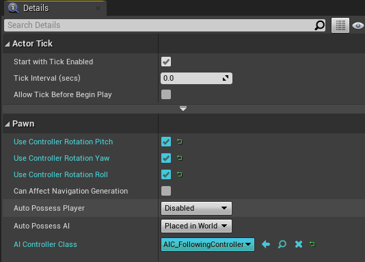

<span id="step11"></span>

##### Step 11

The only thing left is to fill in the `BT_FollowingBehavior` behavior tree.
First, set the `Blackboard Asset` to `BB_FollowingPawn`.

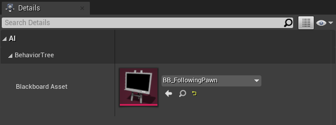

Create a Sequence, then a Wait node and a Move To node.

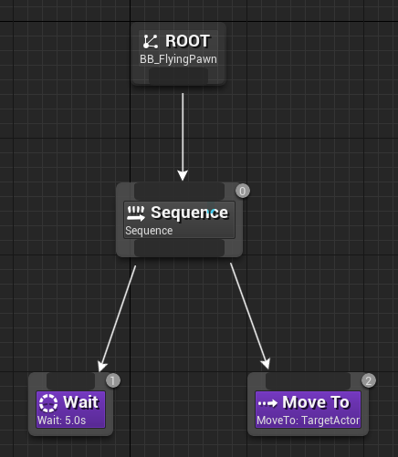

!!! info "The Move To Behavior Tree Node"

    That’s right, the Flying Navigation System uses the *same* Move To node as standard nav walking!
    Which system the node uses to find a path is determined by MovementComponent settings of the Pawn it is controlling (`Nav Movement/Movement Capabilities`).
    We changed this earlier in our `BP_FollowingPawn`.

It’s highly recommended that you turn off `Allow Partial Path` on the Move To node, to prevent searching the whole world if the target is inaccessible.
The pathfinding algorithm will try to guess the closest point to the target if it’s in a blocked area.

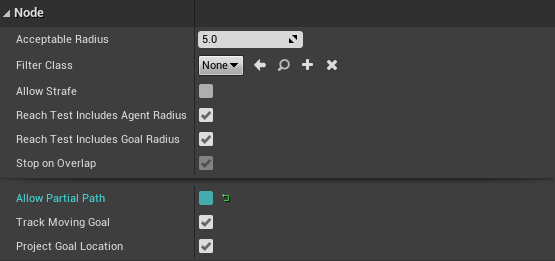

!!! warning "IMPORTANT"

    The behaviour tree node does not use async pathfinding (at the moment, updates are planned), which means it should only be used with simple scenes or pathfinding speed optimisations.

<span id="step12"></span>

##### Step 12

Drag your `BP_FollowingPawn` into your level, press play and give it a go! Our following pawn should follow you around the level, even underneath the floor!

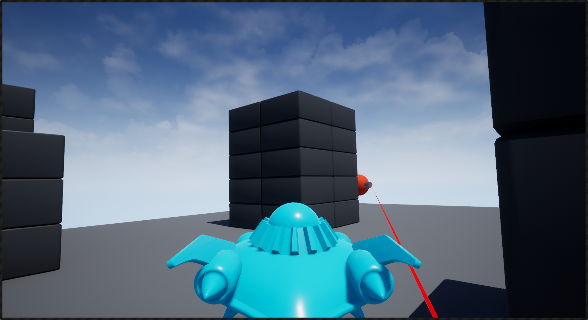

!!! info "Debug path drawing"

    You can see the path the AI calculates by enabling `Draw Debug Paths` on the `FlyingNavigationData` actor in the level.

<span id="step13"></span>

##### Step 13

It can be rather difficult to see what the AI was actually doing in the flying simulator, so you can delete the `FlyingPawn` from the template level and add a `DefaultPawn` (Search `DefaultPawn` under `Engine C++ Classes`).

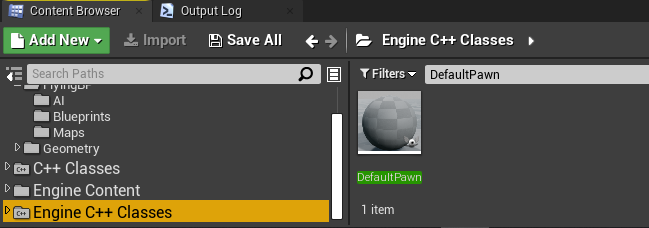

If you set `Auto Possess Player` to `Player 0` and bump up the `Max Speed` on the `DefaultPawn`, you can give the AI a run for its money.

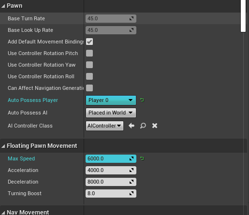

!!! success "Congratulations!"

    You've successfully created your first flying agent!

<span id="where-section"></span>

## Where to next?

For more details on the Flying Navigation System, check out the [usage](usage.md) page.
If you have problems, check out the [troubleshooting](troubleshooting.md) page.
