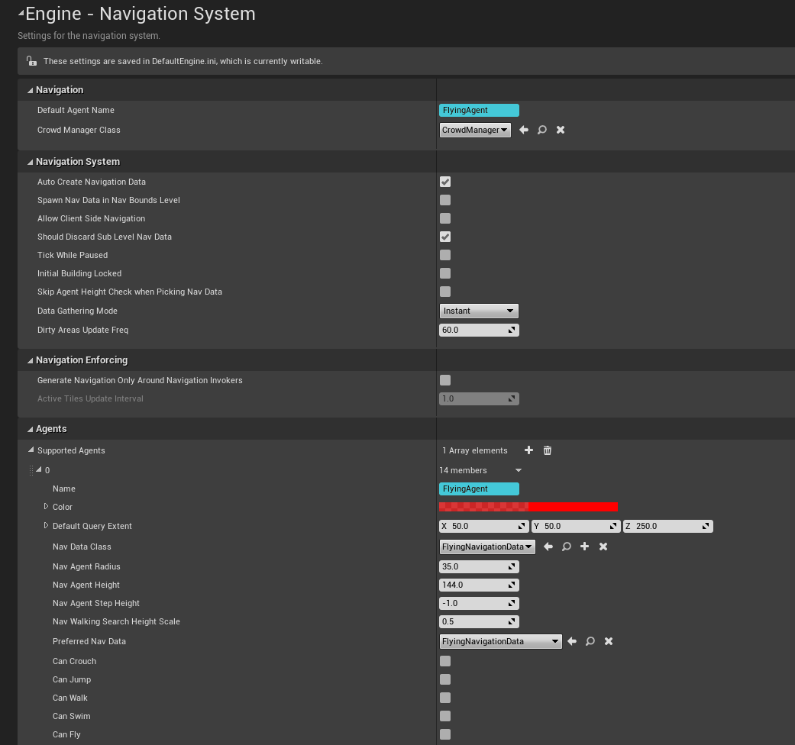
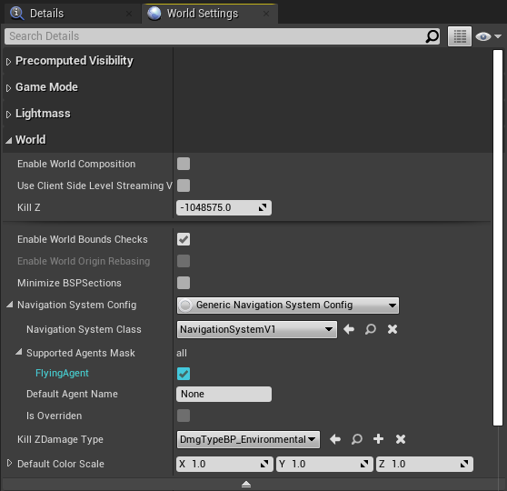
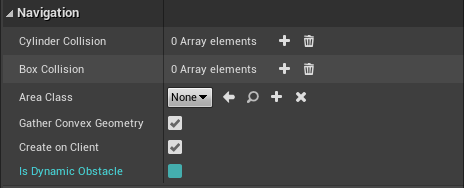
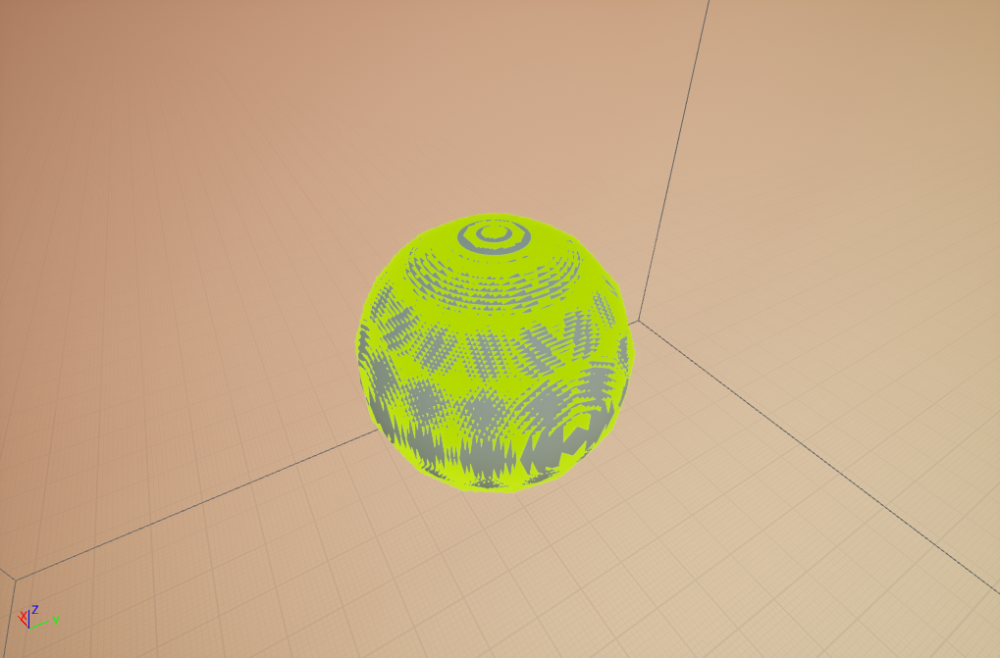
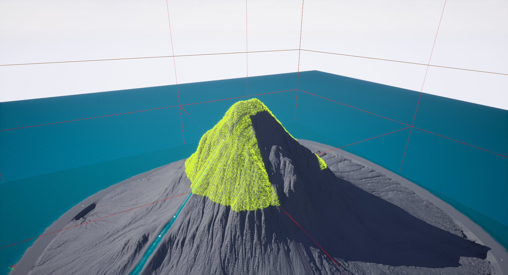
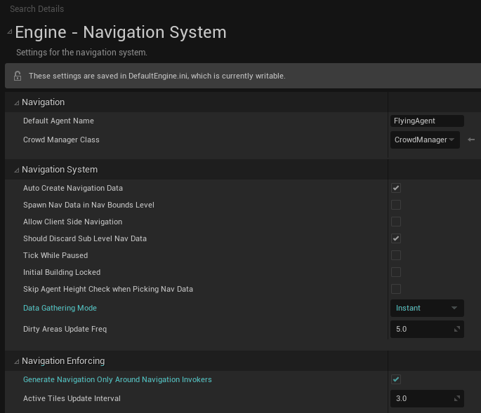

# Troubleshooting

<span id="limitations"></span>

## Limitations

<span id="ai-implementation"></span>

### AI Implementation

This plugin does not contain any movement components or behaviour trees.
It only implements 3D pathfinding algorithms.
The CrowdSystem is currently not supported for flying agents (as it requires
specific features of the navmesh).

<span id="runtime"></span>

### Runtime Generation

Runtime Generation is partially supported.
Setting Runtime Generation to `Dynamic` allows for procedural levels,
or a manually triggered rebuild.
However, constantly moving objects (such as moving platforms) as blocking meshes
are not supported, nor are blocking rigid bodies.
Please see [here](usage.md#runtime) for more
details.

<span id="navarea"></span>

### Navigation Areas and Modifier Volumes

Does not currently support navigation areas or modifier volumes.
All areas within the octree have the same cost of traversal, however the
pathfinding algorithm has various optimisations to bias the result towards
larger areas.
Please see [here](usage.md#pathfinding) for more
details.

<span id="streaming"></span>

### Level Streaming

Does not currently support level streaming, and will load the entirety of the
world’s navigation data on level load. Due to the compact nature of the data
structure, chunking of the octree data structure is not currently implemented.
However, enabling the `Spawn Nav Data in Nav Bounds Level` setting in
Project Settings means different navigation data can be serialised to different
sublevels and manually loaded as required.

<span id="performance"></span>

### Pathfinding Performance

3D pathfinding is inherently not as fast as the default 2D navmesh pathfinding
(due to the very large search space),
and therefore finding the absolute shortest path is often not performant.
Optimisations to increase speed at the cost of accuracy have been implemented,
please see [here](usage.md#pathfinding) for more
details.
There is also the option of asynchronous pathfinding using the C++ function:

```cpp
uint32 FindPathAsync(UNavigationSystemV1* NavSys, const FNavAgentProperties& AgentProperties, FPathFindingQuery Query, const FNavPathQueryDelegate& ResultDelegate, EPathFindingMode::Type Mode = EPathFindingMode::Regular);
```

in `UFlyingNavFunctionLibrary`. From Blueprints you can use the
`Find Path To Actor/Location Asynchronously` nodes.
Please Note: when using flying navigation, do not use the default
`UNavigationSystemV1::FindPathAsync`, as it can cause a crash on PIE
exit.
At the present time, the behaviour tree task `MoveTo` performs
pathfinding synchronously, so optimisations are recommended for complex scenes
if you are using behaviour trees.

<span id="viewport-performance"></span>

### Viewport Drawing Performance

The octree drawing code is designed to be very performant in the viewport.
The octree nodes do not use the `DebugDraw` functions and will
therefore scale very well.
However, the neighbour connection drawing does use `DebugDraw`
functions, and should not be used for high resolution octrees.
Also, the visualisation gathering step (copying data from the navigation data to
the rendering thread) will block the main thread,
and runs whenever a navigation data option is modified. This means that changing
options will lag slightly,
depending on the currently built resolution. It's recommended to build on a
lower resolution to change options, or clearing and rebuilding the navigation
data.

<span id="octree"></span>

### One Octree per Level

Can only generate *one* octree per world per agent.
Can be optimised by only placing navigation volumes around where your meshes
are, as only the meshes in volumes will be taken into account.
However, you can generate octrees in different places by defining multiple agent
types in project settings.
By creaing differently named blank subclasses of
`AFlyingNavigationData` in C++ (one per agent type), the requirement
for different agent radii and heights can be mitigated.

[Request a feature on GitHub](https://github.com/BlenderSleuth/FlyingNavSystemSupport/issues)

<span id="troubleshooting"></span>

## Troubleshooting

<span id="actor-not-moving"></span>

### My Actor Isn't Moving!

There are quite a few things that could lead to an AI actor being
non-responsive. Listed are the most common reasons, if these don't work please
open an issue on GitHub.

1. A FlyingNavigationData actor is required, which should be automatically
   spawned in the level (see below).
2. If an invalid default agent is selected in Project Settings, pathfinding
   can fail.

   
3. If using multiple agent types, make sure that at least one of the radius, height and step height of each agent is different from each other.
   These properties are used as a key hash in a lookup table, so if they're all the same only one is ever registered (the one furthest down the table).
   This logic is in `UNavigationSystemV1::GetNavDataForProps`, and is the source of many headaches when working with multiple agents.
   It's worth becoming familiar with this function if you're having issues with multiple agents.
4. The AI controller needs to be requested to move.
   Using `MoveTo` or a behaviour tree does this for you, but for
   the `FindPath*` nodes you need to use the [Request Move](usage.md#request-move)
   node.
5. The PathFollowingComponent of the AIController might be a
   CrowdFollowingComponent. Make sure you're not using a
   DetourAICrowdController.
   The CrowdSystem is currently not supported for flying agents (as it
   requires specific features of the navmesh).

<span id="not-spawning"></span>

### FlyingNavigationData Actor Not Spawning

In order for pathfinding queries to work, a FlyingNavigationData actor needs to
spawn in the world.
This will occur if you have done the following:

1. Created an agent in Project Settings with
   `Preferred Nav Data` set to
   `Flying Navigation Data`.
2. Checked your agent is supported under
   `Supported Agents Mask`, in both Project Settings and World
   Settings (under
   `World/Navigation System Config/Supported Agents Mask`)

   
3. Placed a `Nav Mesh Bounds Volume` in the world.
4. Reopened the level.

<span id="blocking-mesh"></span>

### Mesh is Blocking and Shouldn’t Be / Non-blocking and Should Be

There are 3 options which affect a mesh's blocking status. In order for a
mesh to be blocking, it must have these options:

1. `Collision/Can Ever Affect Navigation = true`
2. `Physics/Simulate Physics = false`
3. `Navigation/Is Dynamic Obstacle = false` in the Static Mesh
   *asset* settings.

   

Conversely, toggling any of these settings will make the mesh non-blocking.
In most cases the best option is setting
`Collision/Can Ever Affect Navigation = false` on the Static Mesh
spawned or placed in a level.
The `Is Dynamic Obstacle` option impacts all instances of that
Static Mesh, and so could be useful for always non-blocking meshes.
And obviously `Simulate Physics = true` is a simulated rigid
body.
A reload may be required before building the navigation for the changes to
take effect.

<span id="nodeindex"></span>

### Unreal Engine crash with `Assertion failed: InNodeIndex < (1 << 22)`

This means you have pushed the Max Detail Size too far, and the node index
parameter has overflowed.
To fit nodes compactly, unique identifiers need to fit into a 32 bit
integer,
22 bits of which are reserved for the node index in a given layer.
The number of nodes in a layer has exceeded `2^22 = 4,194,304`,
and you should really increase that Max Detail Size.
We can pretty much guarantee that you don't need it that low, but if you
think you do open an issue on [GitHub](https://github.com/BlenderSleuth/FlyingNavSystemSupport/issues) and we'll see what we can do.

<span id="linking-error"></span>

### Cannot open include file: '\*.h': No such file or directory | A verbose and unhelpful linking error such as:

```text
unresolved external symbol "__declspec(dllimport) public: bool __cdecl FSVOLink::IsValid(void)const " (__imp_?IsValid@FSVOLink@@QEBA_NXZ) referenced in function "public: enum ENavigationQueryResult::Type __cdecl FSVOPathfindingGraph::FindPath(struct FVector const &,struct FVector const &,struct FSVOQuerySettings const &,class TArray<struct FNavPathPoint,class TSizedDefaultAllocator<32> > &,bool &)" (?FindPath@FSVOPathfindingGraph@@QEAA?AW4Type@ENavigationQueryResult@@AEBUFVector@@0AEBUFSVOQuerySettings@@AEAV?$TArray@UFNavPathPoint@@V?$TSizedDefaultAllocator@$0CA@@@@@AEA_N@Z)
```

If you wish to access the plugin C++ API, you will need to link against
`FlyingNavSystem`. You will also need to link against the
`NavigationSystem` module if you call parts of the built in
Navigation System.
In your project `.Build.cs` file, you should have:

```c
PublicDependencyModuleNames.AddRange(new string[] { "Core", "CoreUObject", "Engine", "InputCore", "NavigationSystem", "FlyingNavSystem"});
```

For example, in the benchmark project I use
`FNavigationQueryFilter` to perform a path query, which requires
linking to `NavigationSystem`.

<span id="goal-blocked"></span>

### Goal Location in Blocked Volume when using a Pawn as a Pathfinding Goal

When using a Pawn as a pathfinding goal, it is a good idea to set the
`Base Eye Height` to zero.
Otherwise, the pathfinding algorithm will use the bottom (or ‘feet’) of the
Pawn as the goal location, rather than the centre.
The feet are more likely to be inside a blocked area.
**Note:** This does not apply to Characters, which unfortunately uses a
hardcoded `CapsuleComponent->Bounds.BoxExtent.Z` offset for the
feet.

<span id="sphere"></span>

### Sphere Meshes Poke out of the Voxels

Using a sphere primitive as the simple collision on a mesh can sometimes be
inaccurate, as the builtin geometry gathering code converts it to a low-res
triangle approximation.
This can mean bits of spheres poke out of the voxels, but this can be
rectified with the `Use Agent Radius` checkbox under the advanced
`Generation` options.



<span id="getnavdata"></span>

### FNavigationSystem::GetNavDataForActor(AActor) returns `nullptr`

`FNavigationSystem::GetNavDataForActor(AActor)` and
`UCharacterMovementComponent::GetNavData()` will not return a
`AFlyingNavigationData` in 4.24, as it casts to
`ARecastNavMesh`.
**Note:** Fixed in 4.25 and up.

<span id="lazygeometry"></span>

### Some octants of the bounds are not rasterised properly (landscapes)



If "Data Gathering Mode" is set to "Lazy" and "Generate Navigation Only
Around Navigation Invokers" is turned on, the landscape geometry is not
available on every thread.
Therefore, only some octants have access to that data. The current
workaround is to set Data Gathering Mode to "Instant" and reload the level.
This only needs to be done at build time, so it can be changed back to
"Lazy" for production.



If you're still having problems, please don't hesitate to open an issue on [GitHub](https://github.com/BlenderSleuth/FlyingNavSystemSupport/issues) or have a chat on the [Discord](https://discord.gg/hcJVQKCzNQ).

[Report a bug on GitHub](https://github.com/BlenderSleuth/FlyingNavSystemSupport/issues)
