# Usage

<span id="terminology"></span>

## Terminology

<span id="recast"></span>

#### Recast

[Recast](https://github.com/recastnavigation/recastnavigation) is a third-party library for automatic navmesh
generation, distributed with Unreal Engine.
This is the normal navigation you would be familiar with for NavWalking
characters.

<span id="UNavigationSystem"></span>

#### UNavigationSystem

A singleton class owned by the `World` which handles all navigation
queries and building requests, delegating to the relevant
`NavigationData` actor.
It is implementation agnostic.

<span id="ANavigationData"></span>

#### ANavigationData

This is an actor that is automatically spawned in the world when a
`NavMeshBoundsVolume` is added to the level.
This actor contains a specific navigation implementation.
`ARecastNavMesh` and `AFlyingNavigationData` are both
subclasses of `ANavigationData`, where `ARecastNavMesh`
implements Recast pathfinding and `AFlyingNavigationData` implements
a Sparse Voxel Octree for 3D pathfinding.

<span id="FNavAgentProperties"></span>

#### FNavAgentProperties

Used in `Project Settings->Navigation System/Supported Agents` and
`UNavMovementComponent/Movement Capabilities`.
This is a simple struct that defines an agent to the navigation system.
It specifies the agent radius, height, step height and most importantly which
`ANavigationData` actor it uses for pathfinding.
To use the Flying Navigation System, set `PreferredNavData` to
`AFlyingNavigationData` in your flying Pawn's movement component.

!!! info "How the Navigation System chooses a
`NavigationData` for a given pawn"

    The pawn must have a MovementComponent derived from
    `UNavMovementComponent` in order to be involved in AI
    pathfinding.
    This includes `UPawnMovementComponent`, and therefore
    `UFloatingPawnMovement` and
    `UCharacterMovementComponent`.
    `UNavMovementComponent` has a
    `FNavAgentProperties` setting called
    `Movement Capabilities`,
    which determines what kind of agent the pawn is.
    The Radius and Height can be auto-set with the
    `Update Nav Agent With Owners Collision` option, but I
    wouldn't recommend this for reasons detailed below.
    Setting the `PreferredNavData` to
    `FlyingNavigationData` will make sure the pawn uses the
    Flying Navigation System.
    However, sometimes you will want to build multiple octrees, one for a
    large radius and one for a small radius.
    In this case, you would set up multiple agents in Project Settings, each
    with a different radius and/or height.
    This will spawn multiple `FlyingNavigationData` actors in
    your level, for which you can set different `MaxDetailSize`
    etc.
    Now, to choose which `FlyingNavigationData` to query, the
    agent calls:

    ```cpp
    NavSys->GetNavDataForProps(AgentProps, AsNavAgent->GetNavAgentLocation());
    ```

    This function iterates through the available `NavigationData`
    actors to find the one with the closest Radius and Height.
    In essence, all this means is that the first priority is
    `PreferredNavData`, then `AgentRadius` and
    `AgentHeight`.
    This is why I wouldn't recommend automatically setting the value with
    the `Update Nav Agent With Owners Collision` option.
    If you match up the values exactly between Project Settings and
    `Movement Capabilities` everything should work as expected.

<span id="Octree"></span>

#### Octree

A data structure which partitions a 3D space by recursively subdividing a cube
into eight subcubes. Each node as 0 or 8 children.
A Sparse Voxel Octree (SVO) is an octree which is designed to have most of its
volume empty.
Storage space and computation time are concentrated in the detailed areas, and
not wasted in large open spaces.

[](https://commons.wikimedia.org/wiki/File:Octree2.svg "WhiteTimberwolf, PNG version: Nü, CC BY-SA 3.0 <http://creativecommons.org/licenses/by-sa/3.0/>, via Wikimedia Commons")

<span id="nodes"></span>

#### Nodes and SubNodes

A node of the octree is one of those subdivisions in the diagram above.
It’s easiest to visualise it as a node of the tree on the right.
For memory efficiency, the Flying Navigation System also has SubNodes, due to
the way it stores the smallest voxels.
Each ‘Leaf node’ is actually a 4x4x4 voxel grid of SubNodes, stored in a 64-bit
integer.
As such, each SubNode uses 1 bit of space.
`Actual Voxel Size` in the `FlyingNavigationData`
properties refers to the size of these SubNodes.
For more details on how this works, please see [3D Flight Navigation Using Sparse Voxel Octrees](http://www.gameaipro.com/GameAIPro3/GameAIPro3_Chapter21_3D_Flight_Navigation_Using_Sparse_Voxel_Octrees.pdf) by
Daniel Brewer.

<span id="NavigationOctree"></span>

#### NavigationOctree

It is important to note that the `NavigationOctree` specifically is
not the SVO of the Flying Navigation System.
The `NavigationOctree` is a UE4 default octree structure owned by the
`NavigationSystem`, which stores the world geometry in an efficient
manner.

<span id="rasterization"></span>

#### Rasterization (or Rasterisation)

In general, a process that converts a perfect mathematical representation (such
as an SVG image) of something into a regular grid (such as a bitmap image).
In video games this usually refers to converting a scene into screen pixels, but
in the Flying Navigation System rasterisation is the step in building the octree
in which voxels are tested against the world geometry to check if they
intersect.
The building process creates a version of the scene made entirely of voxels
("Volumetric Pixels").

<span id="async"></span>

#### Async Processes

Most of the code we write for video games is run synchronously, which means its
designed to run in the same process as the `Tick` function.
If this code takes longer than a frame, then the framerate of the entire game
drops.
Asynchronous processes do not block the frame rate if they take too long, and
therefore can be used for intensive processes and calculated in the background.
All Octree building processes are asynchronous except for the visualisation.
Disabling `Allow Drawing in Game World` will make sure there will be
no drop in frame rate from dynamic rebuilding.
Pathfinding operations from `AI Move To`,
`Find Path To Actor/Location Synchronously` and behaviour trees are
all run on the main thread, and can cause frame rate drops with large scenes.
`Find Path To Actor/Location Asynchronously` along with the
`Request Move` node perform pathfinding in the background, this is
the recommended approach for scenes with many octree layers (Subdivisions > 7).

<span id="nav-sys"></span>

## Navigation System

To enable async pathfinding to take more than 1 frame to calculate (which may be
required for more complex queries), set the `Navigation System` property
in `World Settings` to be `Flying Navigation System` (since
plugin version 1.0.18). This does not interfere with any other navigation method,
including recast.

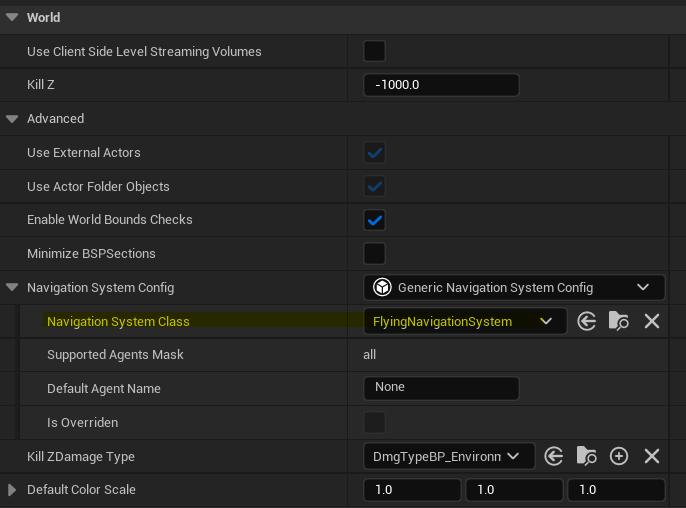

<span id="generation"></span>

## Generation

For all of these properties, each time they're updated, the viewport display is also
updated.
For a responsive details panel, disable the `Enable Drawing` checkbox
before changing any values.

<span id="clear-data"></span>

#### Clear Navigation Data

Deletes SVO stored by this navigation data.

<span id="rebuild-data"></span>

#### Rebuild Navigation Data

Rebuilds SVO stored by this navigation data.
This button does the same thing as `Build->Build Paths` in the
toolbar.

<span id="cancel-rebuild"></span>

#### Stop Rebuild

Cancels rebuild of SVO.

<span id="max-detail-size"></span>

#### Max Detail Size

Size in Unreal Units (cm) of the smallest details that can be captured. Display
only.

<span id="subdivisions"></span>

#### Subdivisions

Number of layers the Sparse Voxel Octree will generate, including the SubNode
layers. Display only.
Updated on nav bounds or MaxDetailSize change.

<span id="actualvoxelsize"></span>

#### Actual Voxel Size

Actual side length of the smallest voxels. Display only.
Updated on nav bounds or MaxDetailSize change.

!!! info "How the Subdivisions and Actual Voxel Size values are
calculated"

    The SVO cube side length is the largest of the edges of the Nav Mesh Bounds
    Volume.
    The number of subdivisions is calculated as the lowest integer N such that
    `(SideLength / 2^N) <= MaxDetailSize`.
    In code, this is

    ```cpp
    Subdivisions = FMath::CeilToInt(FMath::Log2(SideLength / MaxDetailSize));
    ```

    ActualVoxelSize will update to the actual (smaller) voxel size when the nav
    bounds or MaxDetailSize change,
    to indicate the size of the SubNodes.
    The actual voxel side length can be calculated as the inverse operation:
    `ActualVoxelSize = SideLength / (2^Subdivisions).`
    Due to the Ceiling operation, `ActualVoxelSize <= MaxDetailSize`.
    Please note that the minimum number of subdivisions is 4, so the maximum
    Actual Voxel Size is `SideLength / 16`.

<span id="currently-built"></span>

#### Currently Built

Shows if the cached nav data can be used for pathfinding. Display only.
Updated on rebuild, nav bounds or MaxDetailSize change.

<span id="begin-play"></span>

#### Build on Begin Play

When using `RuntimeGeneration = Dynamic`, whether to build once on
`BeginPlay`.
Useful for procedurally generated levels.

!!! danger "Warning!"

    Large performance hit if used with very small detail size or very large
    scene.

<span id="multithreaded"></span>

#### Multithreaded

Build on multiple threads (highly recommended). Runs 8Thread Subdivisions threads.

<span id="ThreadSubdivisions"></span>

#### Thread Subdivisions

How many times to initially subdivide the generation volume. Runs each
subdivision on a separate thread. Increases the allowed minimum subdivisions.

<span id="max-threads"></span>

#### Max Threads

Maximum number of threads to spawn when rasterising the level. If set to >=
available CPU threads, can lock your computer for a while.

<span id="use-agent-radius"></span>

#### Use Agent Radius

Whether to expand the voxel collision test by the AgentRadius (See
`Project Settings->Navigation System`).
This is useful for making sure large agents don’t collide with objects.
The building process will expand triangles along their normals to ‘inflate’ the
geometry by the agent radius.
However, this option should be used with caution, as you don’t want small agents
to end up inside geometry.

!!! info "MaxDetailSize can be a better option than Use Agent
Radius"

    Instead of using this option, a larger `MaxDetailSize` is a good
    and fast way to navigate scenes with a large agent.
    Remember, you can build multiple octrees by specifying multiple agents in
    `Project Settings->Navigation System/Supported Agents`.

!!! warning "BSP level geometry"

    Utilising BSP level geometry with subtraction volumes can give inaccurate
    results when using `Use Agent Radius`,
    because the resulting mesh is non-watertight.

<span id="pathfinding"></span>

## Pathfinding

The default query settings in the details panel of the FlyingNavigationData actor
are used by default,
if no AControllers implement the UFlyingObjectInterface.

<span id="algorithm"></span>

#### Pathfinding Algorithm

Algorithm to use for pathfinding.
A\* is the fastest, but produces jagged paths (no line-of-sight checks).
Theta\* is the slowest and finds the shortest path.
Lazy Theta\* is faster but less accurate than Theta\* (recommended).

<span id="partialpaths"></span>

#### Allow Partial Paths

Whether to find a path despite the goal not being accessible.

!!! danger "Warning!"

    Can cause a large performance due to the algorithm searching the
    entirety of the available space. Not recommended.

<span id="heuristic-scale"></span>

#### Heuristic Scale

How much to scale the A\* heuristic by. High values can speed up pathfinding, at
the cost of accuracy.
All three pathfinding algorithms use the standard distance heuristic to speed up
processing time.
This scale weights the algorithm towards or away from using the heuristic, using
the following formula:

```cpp
float TotalCost = TraversalCost + DistanceToGoal * HeuristicScale;
```

<span id="unit-cost"></span>

#### Use Unit Cost

Makes all nodes, regardless of size, the same cost. Speeds up pathfinding at the
cost of accuracy (AI prefers open spaces).
By default, the cost to traverse a node will be the distance between nodes.
However, this can make the algorithm spend lots of processing time in the dense
areas trying to find an optimal route.
By making each node cost the same, the algorithm can quickly find a path in open
spaces without looking through the smaller nodes.

<span id="node-compensation"></span>

#### Use Node Compensation

Compensates node size even more, by multiplying node cost by 1 for a leaf node,
and 0.2 for the root node. It uses the following formula:

```cpp
TotalCost *= (1.f - LayerProportion * 0.8f);
```

Where `LayerProportion` is 0 for a leaf neighbour and 1 for the root
node.

<span id="pawn-centre"></span>

#### Use Pawn Centre For Path Following

Compensate path points to make flying pawns follow the path through their
centre, rather than their feet.
Due to the fact the Flying Navigation System uses the existing navigation
infrastructure, there are certain default behaviours for walking nav agents that
are not useful for flying agents.
One of these is the `PathFollowingComponent` of the
`AIController`, which will move the pawn along the ‘feet’ location,
defined by the `Bounds.BoxExtent.Z` of the UpdatedComponent of the
MovementComponent.
This option will translate the path up to compensate, to make sure the pawn
flies through its centre.

<span id="debug-colour"></span>

#### Debug Path Color

The color used to debug draw the navigation paths (see Display/DrawDebugPaths)

<span id="geometry"></span>

## Geometry

<span id="clear-geometry"></span>

#### Clear Geometry Drawing

Clears lines from viewport.
Calls `FlushPersistentDebugLines` to remove drawn debug geometry
(will clear other debug drawings).

<span id="draw-geometry"></span>

#### Draw Geometry

Draw triangles the flying navigation system will use to rasterise octree.
Useful for checking functionality of Use Agent Radius, which expands geometry to
prevent clipping.

<span id="display"></span>

## Display

It is recommended to test out these settings on a large max detail size, so the
viewport updates quickly.

<span id="enable-drawing"></span>

#### Enable Drawing

If set to true then this navigation data will be drawing itself when requested as
part of "Show Navigation" (shortcut P).

<span id="draw-nodes"></span>

#### Draw Octree Nodes

Whether to draw the Nodes of the Octree. This option does not apply to SubNodes.

<span id="draw-subnodes"></span>

#### Draw Octree SubNodes

Whether to draw the SubNodes of the Octree. This option does not apply to Nodes.

<span id="overlapped-subnodes"></span>

#### Draw Only Overlapped SubNodes

Draw only SubNodes that overlap geometry.

<span id="colour-connected"></span>

#### Colour By Connected

Colours nodes based on which are connected sections. If disabled, colours from
Red to Blue based on layer (Red for root, Blue for SubNode).

<span id="node-margin"></span>

#### Node Margin

Amount to shrink display voxel extent by, to make it easier to read (absolute
measure).
Can be useful to prevent flickering with high Wire Thickness.

<span id="thickness"></span>

#### Wire Thickness

Thickness of wire in octree visualisation, relative to box size. 1.0 is a solid
box.

!!! danger "Warning!"

    Don't use as a slider because the viewport can lag if the octree is
    built with a small detail size. Enter a discrete value instead.

<span id="neighbour-connections"></span>

#### Draw Neighbour Connections

Whether to draw neighbour lines between Nodes and SubNodes. For connections
between SubNodes, the Draw Only Overlapped SubNodes should be
`false`.

!!! danger "Warning!"

    Uses slow drawing - do not use for high resolution visualisation.

<span id="simplified"></span>

#### Draw Simplified Connections

Whether to only draw node connections for performance and clarity.
Disable to show all connections, but not recommended.

<span id="node-radius"></span>

#### Node Centre Radius

Radius of the sphere used to indicate each node centre.

<span id="debug-paths"></span>

#### Draw Debug Paths

Draw NavPath when queried (such as when MoveTo is called). Editor only.

<span id="game-drawing"></span>

#### Allow Drawing In Game World

Allow octree visualisation in PIE or Game World.
To see navigation in a game world, type `` ` `` then
`show Navigation` (only in non-shipping builds).

!!! danger "Warning: Dynamic Rebuilding"

    Using a small detail size and hi-res level WILL cause a performance hit
    when rebuilding in a game world.
    This is what causes the performance hit, because the visualisation data
    gathering runs on the game thread.

<span id="interface"></span>

## UFlyingObjectInterface

By default, pathfinding queries will use the `Default Query Settings` of
the `Flying Navigation Data` (set in the details panel).
If you wish to override these on a per-agent basis, you can implement the
`UFlyingObjectInterface` in the appropriate `AController`.
It only requires one function, `Get Pathfinding Query Settings`, for
which you can make the required structure (or split the return pin).
These settings will override the defaults when this controller queries the
navigation data.

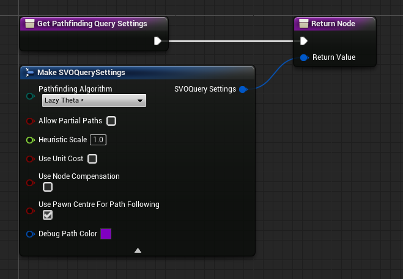

<span id="runtime"></span>

## Runtime Generation

There are three ways to generate and store the octree data structure.

1. Static geometry: cached on disk and loaded into memory on level load.
2. Static procedural geometry: Generated once at the start of the level, no
   caching.
3. Manually triggered generation: Only generated when RebuildFlyingNavigation is
   called from Blueprints or C++.

For option 2 and 3, setting `RuntimeGeneration = Dynamic` is required.

!!! info "DynamicModifiersOnly option"

    `RuntimeGeneration = DynamicModifiersOnly` is the same as
    `Static` for the Flying Navigation System, which doesn't support
    modifiers.

The `Build on Begin Play` option (under `Generation`) is
probably what you want for option 2.
Manually triggering a full-level rebuild is useful for opening a new area of the
map. For example, pressing a button opens a door. A rebuild can be triggered once
the door is open and stopped moving, allowing AI to move through it.
This can be achieved by the `Get Flying Navigation Data` function in
blueprints. The function takes a Pawn as reference and returns the corresponding
`FlyingNavigationData` actor. A rebuild of the data can be called on this
data (which rebuilds the nav data for the entire level), and optionally an
`On Flying Nav Generation Finished` delegate can be set up, to handle
unlocking the game.
Something like this in Blueprints:

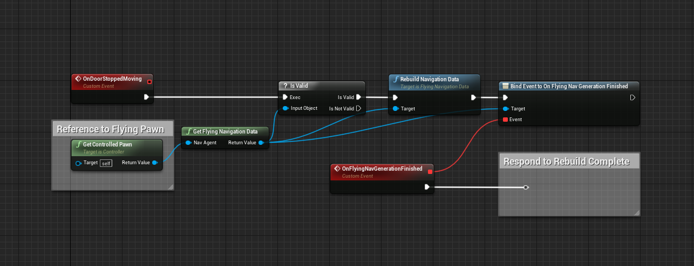

Remember, rebuilding is done asynchronously, so the
`Rebuild Navigation Data` node returning does not signify the completion
of the build.
The Pawn should contain a movement component of some kind, with
`AFlyingNavigationData` set in the `MovementCapabilities`
(otherwise the function will return `nullptr`).
Constantly moving objects such as moving platforms are not taken into account.
This is a limitation of the UE4 geometry gathering system, rather than the Flying
Navigation System (Recast has this limitation too).
It is recommended that a blocking volume is placed anywhere a moving object might
be, to prevent AI collision.
For example, a moving platform between two points:

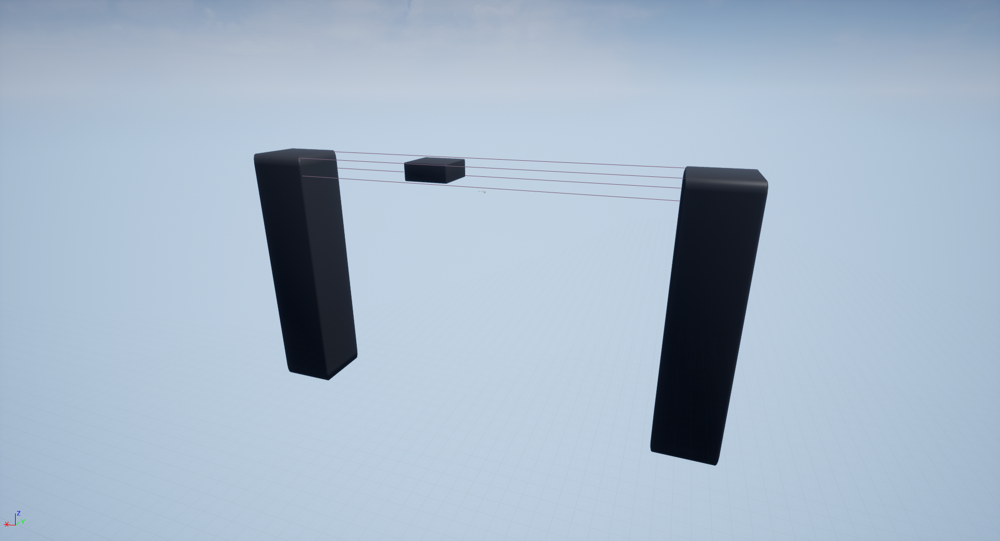

After building:

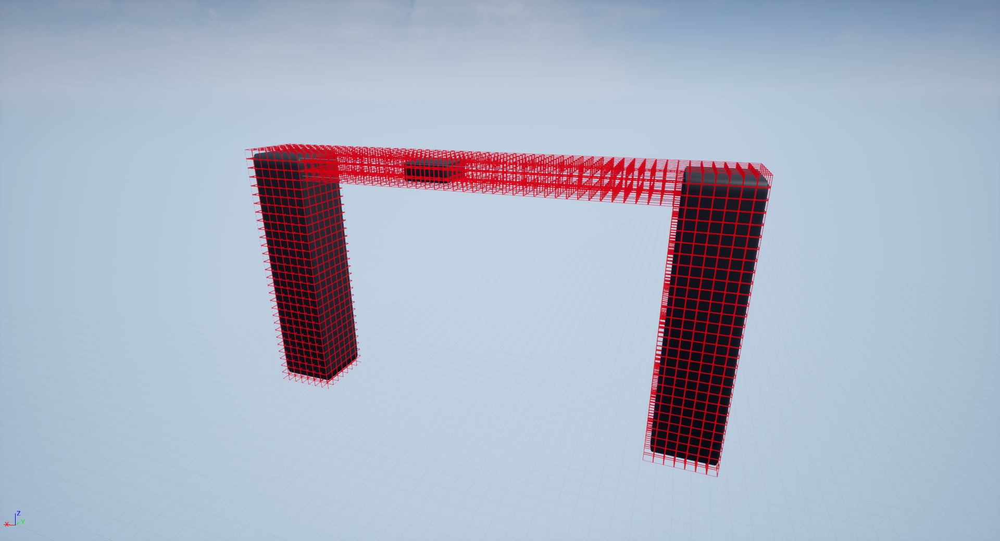

<span id="network"></span>

## Network Replication

The flying navigation system uses the `ANavigationData` class for all
pathfinding, which is a server-only class by default (`bNetLoadOnClient`
is `false`).
This means that all AI pathfinding queries need to be done on the server, and that
trying to access the navigation system will return `nullptr` on a client.
You should use the `HasAuthority()` check before calling
`MoveTo` or similar on the `AIController`, and make sure actor
movement is replicated on the Pawn.
If you require pathfinding access for a player controller or similar, I believe the
best method is to use a Server RPC.
There is also the `Allow Client Side Navigation` option in
`Project Settings->Navigation System` which will replicate the navigation
system and navigation data actors to clients.
However, the SVO data is not replicated because it has the potential to use a lot of
bandwidth, so this option will not work.
If you require a solution of this kind please open an issue on [GitHub](https://github.com/BlenderSleuth/FlyingNavSystemSupport/issues).

<span id="memory-usage"></span>

## Checking Memory Usage

You can check roughly how much memory the octree is using by right-clicking the map
in the content explorer and opening the size map.
The octree memory is inside the `*SELF*` section, which will expand as
you add more layers to the tree.
It also contains other things, but at small detail sizes it can be the majority.

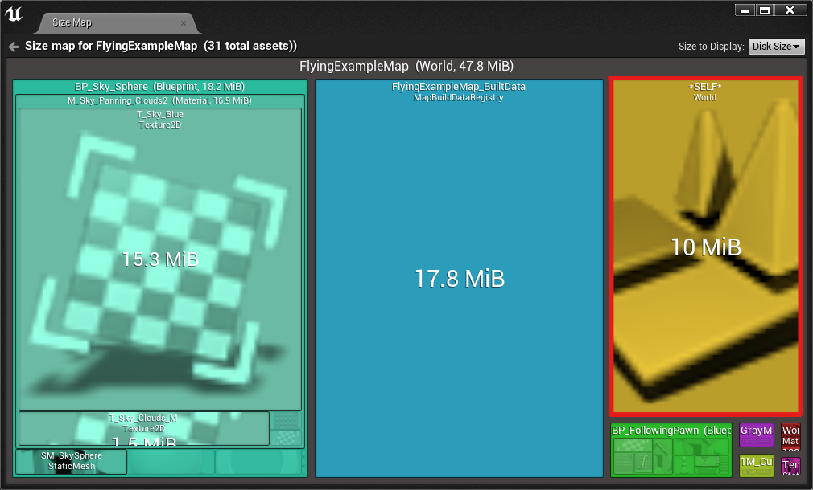

<span id="compile-recast"></span>

## Turning off bCompileRecast

I was considering allowing support for the compile-time parameter
`bCompileRecast = false`, for small mobile builds.
The plugin currently piggy-backs off the Recast geometry gathering code, so I would
need to duplicate much of it for the Flying Navigation System to continue to work.
However, I was not able to get the engine Shipping target (even without the plugin)
to compile without Recast.
Please open an issue on [GitHub](https://github.com/BlenderSleuth/FlyingNavSystemSupport/issues) if this is something you require.

<span id="blueprint"></span>

## Blueprint Functions

These functions can be called from anywhere.

<span id="get-navdata"></span>

#### Get Flying Navigation Data

Get the `FlyingNavigationData` actor for a given Pawn.
Will return `nullptr` if the Pawn's movement component specifies a
different `Preferred Nav Data`.


It's recommended that you use an `Is Valid` node to make sure the
return value exists.

<span id="rebuild-all-flying-nav"></span>

#### Rebuild All Flying Navigation

Rebuild all Flying Navigation Data agents.
To build a specific navigation data, use `Get Flying Navigation Data`
and call `Rebuild Navigation Data` on it.

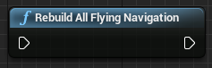

<span id="rebuild-navdata"></span>

#### Rebuild Navigation Data / Rebuild Flying Navigation

Rebuild cached SVO Data for the given Flying Navigation Actor.
`Rebuild Navigation Data` will return instantly and not wait for the
building to complete.
`Rebuild Flying Navigation` will only trigger once building is
completed (or cancelled).

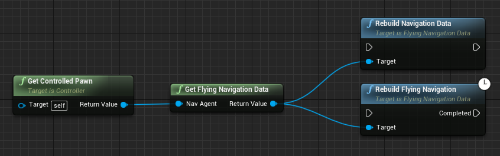

!!! danger "Warning: Dynamic Rebuilding"

    Using a small detail size and hi-res level can cause a performance hit when
    rebuilding. Use with caution (and profiling).
    Turning off `Allow Drawing In Game World` helps.

<span id="stop-rebuild"></span>

#### Stop Rebuild

Cancels rebuild of cached Navigation Data.
Will trigger `Rebuild Flying Navigation` completed pin,
so check `Is Navigation Data Built` to make sure data is available.
Rebuild will not overwrite data until completed.

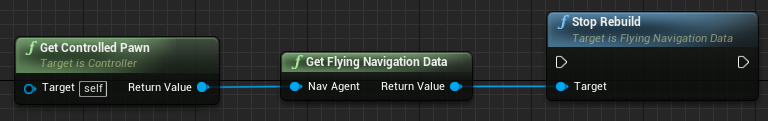

<span id="data-built"></span>

#### Is Navigation Data Built

Checks if navigation data is available for pathfinding or raycasting.

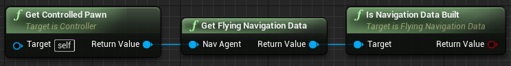

<span id="built-voxel-size"></span>

#### Currently Built Voxel Size

Returns voxel size of currently built navigation data. Returns 0 if not built.

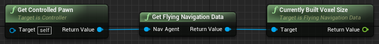

<span id="raycast"></span>

#### Octree Raycast

Fast raycast against the octree. Returns true if object was hit.

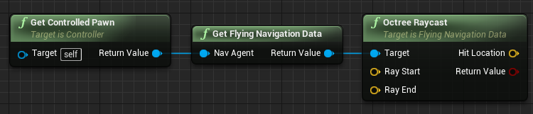

<span id="draw-navpath"></span>

#### Draw Nav Path (Development Only)

Draw the navigation path returned by the
`Find Path To Actor/Location Synchronously/Asynchronously` node.
`Path Offset` will translate the path by a fixed amount.
`Persistent` draws will persist between frames.

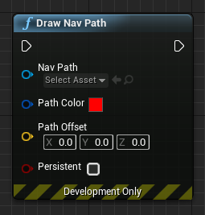

<span id="pathfind-location"></span>

#### Find Path To Location Asynchronously

Finds path on separate thread. The `Completed` pin is triggered once
a path has been found
The `Pathfinding Context` could be one of following:
`NavigationData` (like `FlyingNavigationData` actor),
`Pawn` or `Controller`.
This parameter determines which navigation data actor is chosen and allows
override of SVO Query Settings (see [UFlyingObjectInterface](usage.md#interface)).

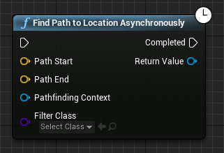

<span id="pathfind-actor"></span>

#### Find Path To Actor Asynchronously

Finds path on separate thread. The `Completed` pin is triggered once
a path has been found
Main advantage over `Find Path To Location Asynchronously` is that
the resulting path will automatically get updated if the goal actor moves more
than `Tether Distance` away from last path node.
Updates when the `Goal Actor` moves are also asynchronous, but only
when doing Flying pathfinding (Recast query updates are processed in the usual
fashion).
The `Pathfinding Context` could be one of following:
`NavigationData` (like `FlyingNavigationData` actor),
`Pawn` or `Controller`.
This parameter determines which navigation data actor is chosen and allows
override of SVO Query Settings (see [UFlyingObjectInterface](usage.md#interface)).

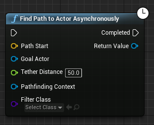

This can be used in a setup similar to the following:

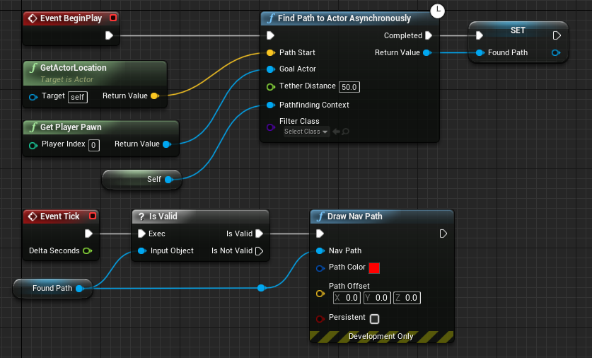

On `BeginPlay`, the actor tries to find a path to the player. Before
the pathfinding completes, `BeginPlay` exits and the level loads
normally.
The `Tick` event runs every frame, but doesn't do anything because
the `Found Path` variable is invalid.
Once the pathfinding is finished, the `Completed` pin triggers, and
saves the path in `Found Path`.
`Tick` can now run `Draw Nav Path` each frame, and as the
player moves the path will update periodically without stalling the game thread.

!!! info "Pathfinding Context"

    When using the
    `Find Path To Actor/Location Synchronously/Asynchronously` family
    of nodes, to prevent bugs it’s a good idea
    to use the controlled pawn (`GetControlledPawn` from a
    `Controller`) or `NavigationData` as the
    `Pathfinding Context`.
    The `Pathfinding Context` is used to choose the correct
    navigation data.
    This is only important if you have multiple agents defined in Project
    Settings.

    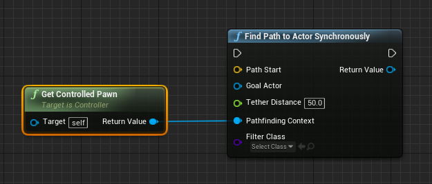

    The `Pathfinding Context` is also important for providing custom
    `FSVOQuerySettings`.
    `Pathfinding Context` can implement the
    `FFlyingObjectInterface` to override the default settings.

<span id="getpathfindingresult"></span>

#### Get Pathfinding Result

Takes a path output from
`Find Path To Actor/Location Synchronously/Asynchronously` and
returns if it was invalid, an error, fail or success:
`Invalid`: If start or end point is blocked or out of bounds.
`Error`: Algorithm got stuck in infinite loop.
`Fail`: If start and end points are not connected and partial paths
are not enabled.
`Success`: Path is valid.

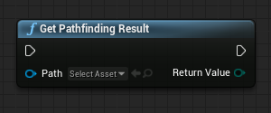

For example, to switch on the result:

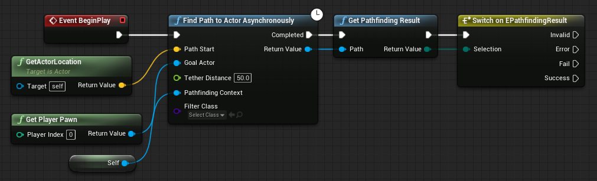

<span id="nav-path-points"></span>

#### Set Navigation Path Points

Allows custom blueprint post-processing of paths. Takes an existing navigation
path, and replaces the path points with the given array of vectors.

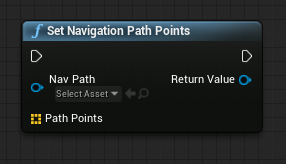

For example, this node can be used to flatten a path to the x-y plane by clearing
the z-component of each path point.

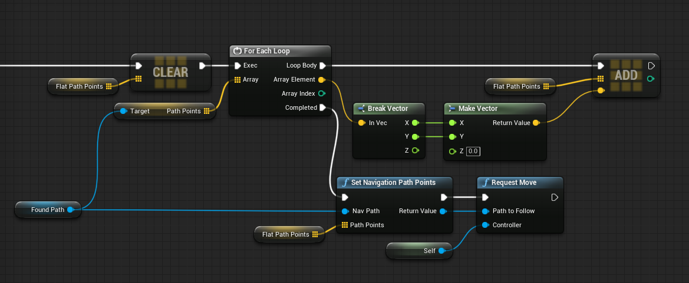

<span id="request-move"></span>

#### Request Move

Takes a path output from
`Find Path To Actor/Location Synchronously/Asynchronously` and
requests an `AIController` to follow it.


For example, to make a pawn find the player when the level starts:

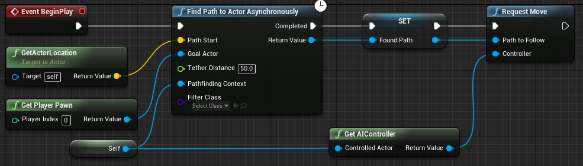

<span id="smooth-path"></span>

#### Smooth Path

Smooths navigation path (from
`Find Path To Actor/Location Synchronously/Asynchronously`) by
constructing a centripetal Catmull-Rom Spline and sampling points at equidistant
intervals.

The `Sample Length` is the distance between samples along the path in
Unreal units.

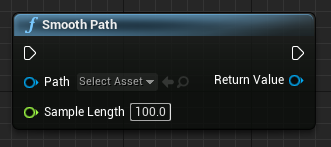

Smoothing looks like this:

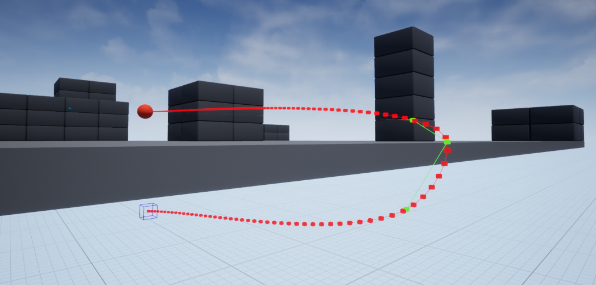

Generated using this graph:

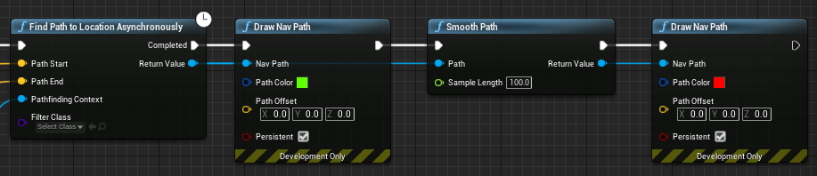

<span id="cr-spline-functions"></span>

#### CatmullRomSpline Object

A Catmull-Rom Spline object can be created and sampled at will using the
`Make Catmull Rom Spline` node. `Path Points` must have at
least 2 points.

This can be used to move objects along splines manually, without sampling at
intervals and passing to `Request Move`.

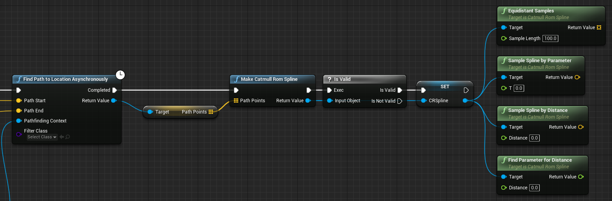

<span id="cpp-api"></span>

## C++ API Reference

If you're building custom query functionality, its a good idea to check out the
source code to see how everything works.
If you downloaded the plugin from the Marketplace, the source will be found at
`C:\Program Files\Epic Games\UE_4.XX\Engine\Plugins\Marketplace\FlyingNavSystem\Source\FlyingNavSystem`
for Windows and
`/Users/Shared/Epic Games/UE_4.XX/Engine/Plugins/Marketplace/FlyingNavSystem/Source/FlyingNavSystem`
for macOS. You should know where it is if you built for Linux 😜.
Here I have put together an easy reference of the most common classes.
If you're doing custom querying, you should call `GetSVOData()` on the
`AFlyingNavigationData` actor, which will return a reference to a
`FSVOData` struct.
You should save it in a `FSVODataRef` if you're holding on to it for a
while. This will give you access to the underlying octree data (Layers, Nodes and
SubNodes).
There is also the `FSVOPathfindingGraph` struct for the underlying
pathfinding algorithm, which can be accessed from
`AFlyingNavigationData::GetSyncPathfindingGraph()` on the game thread.

<span id="nav-system-types"></span>

#### In FlyingNavSystemTypes.h

###### `FlyingNavSystem` namespace:

```cpp
namespace FlyingNavSystem
{
	// Returns a direction vector for the 6 DOF neighbours (Direction is [0, 5])
	FIntVector GetDelta(const int32 Direction);

	// Helper functions for Morton codes
	// Converts a morton coordinate to a real position, using info about the coordinate system. See SVOData::*Offset methods for details about VoxelOffset
	FVector MortonToCoord(const morton_t Code, const FVector& SystemCentre, const float VoxelSideLength, const float VoxelOffset);

	// Converts a small morton coordinate to a real position, using info about the coordinate system. See SVOData::*Offset methods for details about VoxelOffset
	FVector SmallMortonToCoord(const small_morton_t Code, const FVector& SystemCentre, const float VoxelSideLength, const float VoxelOffset);

	// Morton helpers
	morton_t ParentFromAnyChild(const morton_t& ChildCode);
	morton_t FirstChildFromParent(const morton_t& ParentCode);
	morton_t FirstChildFromAnyChild(const morton_t& ChildCode);
	morton_t LastChildFromAnyChild(const morton_t& ChildCode);

	// Math helpers
	// Returns axis aligned unit vector that most matches the direction from A to B
	FVector MajorAxisDirectionFromTwoPoints(const FVector& A, const FVector& B);

	// For a given octree size and max leaf size, how many layers the Octree will have
	int32 GetNumLayers(const float SideLength, const float MaxDetailSize);

	// Random generators
	float Gauss(const float Mean, const float StdDev);
	FVector RandPointInSphere(const float Radius);
    // Returns positions of voxels inside or on a solid sphere, can be slow (O(R^3));
	void RasteriseSphere(const FVector& Centre, const float Radius, const float VoxelSize, TArray<FVector>& SpherePoints);

	// Vertex handling helpers
	const FVector& FloatToVec(const float* Coords, const int32 Index);
	FVector& FloatToVec(float* Coords, const int32 Index);
	FVector& FloatToVec(TArray<float>& Coords, const int32 Index);

    // Copies and converts an array of FNavPathPoints to an array of FVectors
	void ConvertNavPathPointsToVector(const TArray<FNavPathPoint>& In, TArray<FVector>& Out);
}
```

###### `FSVOLink` struct:

```cpp
//----------------------------------------------------------------------//
// FSVOLink
// 
// FSVOLink is a 32-bit Link:
// 4 bits  — Layer index 0 to 15. 0 = Leaf Node Layer, 1-15 Normal Node Layers
// 22 bits — Node index 0 to 4,194,303
// 6 bits  — SubNode index 0 to 63 (only used for indexing voxels inside leaf nodes)
//----------------------------------------------------------------------//
struct FSVOLink
{
	FSVOLink(uint32 InLink = 0);

    // Checked constructor
	FSVOLink(const uint32 InLayerIndex, const uint32 InNodeIndex, const uint32 InSubNodeIndex = 0);

    uint32 GetLayerIndex() const;

	void ClearNodeIndex();
	uint32 GetNodeIndex() const;
	void SetNodeIndex(const uint32 InNodeIndex);
	FSVOLink IncrementNodeIndex(const int32 NodeOffset) const;

	uint32 GetSubNodeIndex() const;

    // Impossible link to indicate an invalid link
	static FSVOLink NULL_LINK;

	bool IsValid() const;

	FString ToString() const;
	NavNodeRef AsNavNodeRef() const;
	
	bool operator==(const FSVOLink Other) const;
	bool operator!=(const FSVOLink Other) const;
	bool operator<(const FSVOLink Other) const;
	FSVOLink operator+(const int32 NodeOffset) const;

	friend FArchive& operator<<(FArchive& Ar, FSVOLink& SVOLink);
	friend uint32 GetTypeHash(const FSVOLink SVOLink);
};
```

###### `FSVONode` struct:

```cpp
//----------------------------------------------------------------------//
// FSVONode
//
// Struct representing an octree node in a layer.
//----------------------------------------------------------------------//
struct FSVONode
{
	FSVOLink FirstChild;
	FSVOLink Parent;
	FSVOLink Neighbours[6];
	morton_t MortonCode;
	bool bHasChildren;

    // Uninitialised FSVONode for efficiency
	FSVONode();
	FSVONode(const morton_t InMortonCode);

	// Sort by morton code
	bool operator<(const FSVONode& Other) const;
};
```

###### `FSVOLeafNode` struct:

```cpp
//----------------------------------------------------------------------//
// FSVOLeafNode
// Contains the voxel grid of SubNodes, and a link to the parent LayerOne node
//----------------------------------------------------------------------//
struct FSVOLeafNode
{
	// 4x4x4 voxel grid packed into a 64bit integer
	uint64 VoxelGrid;

	FSVOLeafNode();

	// Pointer to parent
	FSVOLink Parent;

    // SubNodes stored in Morton Order
	void SetIndexBlocked(const small_morton_t Index);
	bool IsIndexBlocked(const small_morton_t Index) const;

    // All SubNodes are blocked
	bool IsCompletelyBlocked() const;

    // All SubNodes are free
	bool IsCompletelyFree() const;

	friend uint32 GetTypeHash(const FSVOLeafNode& SVOLeafNode);
};
```

###### `FSVOLayer` struct and `FSVOLeafLayer` typedef:

```cpp
//----------------------------------------------------------------------//
// FSVOLayer
// 
// 2D Array Workaround. FSVOData has a TArray<FSVOLayer> to hold each layer
//----------------------------------------------------------------------//
struct FSVOLayer
{
	TArray<FSVONode> Nodes;
	
	// Convenience functions, passes through to Array
	FSVONode& AddNode();
	int32 Num() const;
	void Append(const FSVOLayer& OtherLayer);
	
	FSVONode& GetNode(const int32 Index);
	const FSVONode& GetNode(const int32 Index);
	FSVONode& operator[](const int32 Index);
	const FSVONode& operator[](const int32 Index) const;
	
	void Reserve(const int32 Number);
	void Empty(const int32 Number);

	/*
	* Adds *Num* FSVONodes with bHasChildren = false to Layer, with MortonCode starting from *StartCode*
	*/
	void AddChildlessNodes(const int32 Num, const morton_t& StartCode);

	/*
	* Each layer is a multiple of 8, because every node either has 8 or 0 children. We have the nodes with 8 children
	* from the previous layer, but we need to fill in all the nodes with 0 children as padding.
	*
	* Fills in the amount of childless nodes required to satisfy this requirement when
	* jumping between nodes at FirstMorton and LastMorton, which have children.
	* By default fills in the range (FirstMorton, LastMorton) skipping any completely empty blocks, but can include
	* FirstMorton as a childless node for when the layer generation algorithm begins
	*/
	void PadWithChildlessNodes(const morton_t& FirstMorton, const morton_t& LastMorton, bool bIncludeFirst = false);
};

// For consistency
typedef TArray<FSVOLeafNode> FSVOLeafLayer;
```

###### `FSVOData` struct:

```cpp
//----------------------------------------------------------------------//
//
// FSVOData definition
// 
// Serialisable data containing everything needed for flying pathfinding, with helpers
// Please note that modifying this struct is not thread safe, use a thread lock
//
// Most functions assume bValid to be true, so make sure SVO data is built before trying to access it
//----------------------------------------------------------------------//
struct FSVOData : TSharedFromThis<FSVOData, ESPMode::ThreadSafe>
{
	// Leaf storage, each leaf is a 4x4x4 voxel grid packed into a 64bit integer
	FSVOLeafLayer LeafLayer;

	// Stores Layer 1 to n (in index 0 to n-1)
	TArray<FSVOLayer> Layers;

	// Stores precomputed connectivity between nodes. Nodes with same index are in the same graph
	TMap<FSVOLink, int32> NodeComponent;

	// Transient map for temporary pathfinding nodes (start and end positions)
	mutable TMap<FSVOLink, FVector> TempNodes;
	
	// Metadata (filled in before generation)
	
	// Total bounds in which pathfinding is supported, guaranteed to be a cube
	FBox Bounds;
	// Centre of the full Octree cube
	FVector Centre;
	// Side length of the full Octree cube
	float SideLength;
	// Actual rasterised resolution of Octree
	float SubNodeSideLength;
	// Number of layers [Leaf->Root). Does not include SubNode layers
	int32 NumNodeLayers;
	// Number of graph components in volume (connected areas)
	int32 NumConnectedComponents;
	// Radius of agent this NavData is built for
	float AgentRadius;

	// Flag to mark if NavData can be used or not
	bool bValid;

	FSVOData();

	// Sets octree bounds (centre and side length). Octree is always a cube, even if InBounds is not
	void SetBounds(const FBox& InBounds);
    void SetBounds(const FVector& InCentre, const float InSideLength)

	// Checks if SVO is empty (true if no colliding geometry was used)
	bool IsEmptySpace() const;

	// Invalidates SVOData
	void Clear();

	// Invalidates SVOData and releases resources
	void ReleaseResources();

	//----------------------------------------------------------------------//
	// Node accessors
	//----------------------------------------------------------------------//
	// Get any layer except layer 0 (Use LeafLayer instead)
	FSVOLayer& GetLayer(const int32 LayerNum);

	// Get any layer except layer 0 (Use LeafLayer instead)
	const FSVOLayer& GetLayer(const int32 LayerNum) const;

	// Gets top level node
	const FSVONode& GetRoot() const;
	FSVOLink GetRootLink() const;

	//----------------------------------------------------------------------//
	// Size and offset calculations
	//----------------------------------------------------------------------//

	// Returns side length for any layer. Leaf is Layer 0.
	float GetSideLengthForLayer(const int32 Layer) const;
	// Returns side length for any node link. Useful for when link could be either FSVONode or FSVOLeafNode
	float GetSideLengthForLink(const FSVOLink NodeRef) const;
	
	// Offset is for converting Morton Codes into world or local coordinates
	static float GetOffset(const float SystemSideLength, const float VoxelSideLength);
	// Returns node offset for a given node layer in the SVO.
	float GetNodeOffsetForLayer(const int32 Layer) const;
	// Returns node offset for a SubNode (in the leaf node coordinate system)
	float GetSubNodeOffset() const;

	// Extent calculations to prevent bugs (factor of 0.5f)
	
	// Returns extent of SubNode (for use in FBox::BuildAABB)
	FVector GetSubNodeExtent() const{ return FVector(SubNodeSideLength * 0.5f); }
	// Returns extent of layer (for use in FBox::BuildAABB)
	FVector GetExtentForLayer(const int32 Layer) const;
	// Returns extent of the whole octree (for use in FBox::BuildAABB)
	FVector GetOctreeExtent() const;
	// Returns extent of node references by link
	FVector GetExtentForLink(const FSVOLink NodeRef) const;
	// Returns the FBox for any given node link
	FBox GetNodeBoxForLink(const FSVOLink NodeRef) const;
	
	// Finds a world location for a given non-leaf link, optimised
	FVector GetPositionForNonLeafLink(const FSVOLink NodeRef) const;
	// Finds a world location for any given link, can also return position of leaves and SubNodes
	FVector GetPositionForLink(const FSVOLink NodeRef, bool bSearchSubNodes = true) const;
	// Finds a world location for any given link, can also return position of leaves and SubNodes, but checks TempNodes to override position values
	FVector GetPositionForLinkCheckTemp(const FSVOLink NodeRef, bool bSearchSubNodes = true) const;

	// Snaps given position to regular subnode grid
	FVector SnapPositionToVoxelGrid(const FVector& Position) const;
	
	// Finds a node link for a given world position. By default doesn't return blocked SubNode links
	FSVOLink GetNodeLinkForPosition(const FVector& Position, bool bAllowBlocked = false) const;

	// Returns float in range [0, 1] for 0 = Leaf, 1 = Root
	float GetLayerProportionForLink(const FSVOLink NodeRef) const;

	// Checks if a position is blocked in the SVO representation
	bool IsPositionBlocked(const FVector& NodePosition) const;

    // World Origin Rebasing support
	void ApplyWorldOffset(const FVector& WorldOffset)

	// Fills an array with references to nodes that are empty below a given node reference. Includes leaf and SubNodes
	void GetChildlessNodes(const FSVOLink CurrentNode, TArray<FSVOLink>& ChildlessNodes) const;

	// Fills an array with references to all nodes that are empty. Includes leaf and SubNodes
	void GetAllChildlessNodes(TArray<FSVOLink>& ChildlessNodes) const;

	// Finds random point in sphere (by trial and error). Optionally reachable. Returns true if a position is found
	bool RandomNavigablePointInRadius(const FVector& Origin, const float Radius, FNavLocation& OutResult, const bool bReachable = false) const;
	
	// Returns number of octree subdivisions stored in this SVOData
	int32 GetSubdivisions() const;
	
#if WITH_EDITOR
	// Given a node link, draws the node in world
	void DrawLink(UWorld* World, const FSVOLink Link);
#endif

	// Index of connected component. Invalid links return INDEX_NONE
	int32 GetComponentIndex(const FSVOLink Link) const;

	// Checks if two node references are reachable (blocked nodes are never reachable)
	bool IsConnected(const FSVOLink LinkA, const FSVOLink LinkB) const;

	uint32 GetAllocatedSize() const;
};
```

<span id="navigation-data"></span>

#### In FlyingNavigationData.h

###### `AFlyingNavigationData` class:

```cpp
DECLARE_DYNAMIC_MULTICAST_DELEGATE(FFlyingNavGenerationFinishedEvent);

/**
 * Actor to store navigation data for flying agents
 * Stores single octree
 */
class AFlyingNavigationData : public ANavigationData
{
public:
	// Event to broadcast when finished building
	FFlyingNavGenerationFinishedEvent OnFlyingNavGenerationFinished;

	// Rebuild cached Navigation Data.
    void RebuildNavigationData();

	// Cancels rebuild of cached Navigation Data
    void StopRebuild();

	// Checks if navigation data is available for pathfinding or raycasting
    bool IsNavigationDataBuilt() const;

	// Returns voxel size of currently built navigation data. Returns 0 if not built
    float CurrentlyBuiltVoxelSize() const;

	// Builds Data on game thread (for debugging purposes). Requires RuntimeGeneration = Dynamic
	void SyncBuild();

	// Random point in navigable space
	virtual FNavLocation GetRandomPoint(FSharedConstNavQueryFilter Filter = nullptr, const UObject* Querier = nullptr) const override;
	// Random *reachable* point in radius
	virtual bool GetRandomReachablePointInRadius(const FVector& Origin, float Radius, FNavLocation& OutResult, FSharedConstNavQueryFilter Filter = nullptr, const UObject* Querier = nullptr) const override;
	// Random point in radius
	virtual bool GetRandomPointInNavigableRadius(const FVector& Origin, float Radius, FNavLocation& OutResult, FSharedConstNavQueryFilter Filter = nullptr, const UObject* Querier = nullptr) const override;

	// Projects point to neighbouring empty space if point is inside blocked area. 'Extent' has been renamed to ConnectedComponentPoint, for sorting projection points based on a position
	virtual bool ProjectPoint(const FVector& Point, FNavLocation& OutLocation, const FVector& ConnectedComponentPoint, FSharedConstNavQueryFilter Filter = nullptr, const UObject* Querier = nullptr) const override;
	virtual bool IsNodeRefValid(NavNodeRef NodeRef) const override;

	/** Project batch of points. 'Extent' has been renamed to ConnectedComponentPoint, for sorting projection points based on a position */
	virtual void BatchProjectPoints(TArray<FNavigationProjectionWork>& Workload, const FVector& ConnectedComponentPoint, FSharedConstNavQueryFilter Filter = nullptr, const UObject* Querier = nullptr) const override;

	/** Project batch of points using shared search filter. This version is not requiring user to pass in Extent,
	 *	and is instead relying on FNavigationProjectionWork.ProjectionLimit.
	 *	@note function will assert if item's FNavigationProjectionWork.ProjectionLimit is invalid */
	virtual void BatchProjectPoints(TArray<FNavigationProjectionWork>& Workload, FSharedConstNavQueryFilter Filter = nullptr, const UObject* Querier = nullptr) const override;

	// NOTE: Path cost and path length are the same.
	virtual ENavigationQueryResult::Type CalcPathCost(const FVector& PathStart, const FVector& PathEnd, float& OutPathCost, FSharedConstNavQueryFilter Filter = nullptr, const UObject* Querier = nullptr) const override;
	virtual ENavigationQueryResult::Type CalcPathLength(const FVector& PathStart, const FVector& PathEnd, float& OutPathLength, FSharedConstNavQueryFilter QueryFilter = nullptr, const UObject* Querier = nullptr) const override;
	virtual ENavigationQueryResult::Type CalcPathLengthAndCost(const FVector& PathStart, const FVector& PathEnd, float& OutPathLength, float& OutPathCost, FSharedConstNavQueryFilter QueryFilter = nullptr, const UObject* Querier = nullptr) const override;

	// Checks if a given NavNodeRef (converted to FSVOLink) contains the given location.
	virtual bool DoesNodeContainLocation(NavNodeRef NodeRef, const FVector& WorldSpaceLocation) const override;

	/** Returns bounding box for the flying volume. */
	virtual FBox GetBounds() const override;

	virtual void BatchRaycast(TArray<FNavigationRaycastWork>& Workload, FSharedConstNavQueryFilter QueryFilter, const UObject* Querier = nullptr) const override;

	// Returns bounding box for the whole flying volume.
	FBox GetFlyingBounds() const;

	// Marks the render state dirty (must be run on the game thread)
	void UpdateDrawing();

	// Creates a task to be executed on GameThread calling UpdateDrawing
	void RequestDrawingUpdate(bool bForce = false);

	// Called from generator once building has completed
	void OnOctreeGenerationFinished();

	// Returns point more likely to be in unblocked space. Prefers unblocked space accessible by ConnectedPoint
	FVector ModifyPathEndpoints(const FVector& TargetPoint, const FVector& ConnectedPoint, const float AgentHalfHeight) const;

	// Pathfinding overrides

	// If Query.Owner implements FFlyingObjectInterface, then DefaultQuerySettings will be overridden
	static FPathFindingResult FindPath(const FNavAgentProperties& AgentProperties, const FPathFindingQuery& Query);
	// Precomputed in octree building
	static bool TestPath(const FNavAgentProperties& AgentProperties, const FPathFindingQuery& Query, int32* NumVisitedNodes = nullptr);

	// Fast raycast against the octree
	static bool OctreeRaycast(const ANavigationData* Self, const FVector& RayStart, const FVector& RayEnd, FVector& HitLocation, FSharedConstNavQueryFilter QueryFilter, const UObject* Querier);

	// Fast raycast against the octree
	bool OctreeRaycast(const FVector& RayStart, const FVector& RayEnd, FVector& HitLocation) const;

	// SVO Data accessors, make sure to use SVODataLock if using threading
	FSVOData& GetSVOData();
	const FSVOData& GetSVOData() const;
	FSVOData& GetBuildingSVOData();
	const FSVOData& GetBuildingSVOData() const;

	// Read-Write lock on NavData
	mutable FRWLock SVODataLock;

	// Just for neighbour information
	const FSVOGraph* GetNeighbourGraph() const;
	// Use this Navigation Graph on the game thread
	FSVOPathfindingGraph* GetSyncPathfindingGraph() const;
	// Use this Navigation Graph on any thread other than the game thread. Remember to lock AsyncGraphCriticalSection when using
	FSVOPathfindingGraph* GetAsyncPathfindingGraph() const;
	
	mutable FCriticalSection AsyncGraphCriticalSection;
	
	// Finds the Side length of the SVO cube
	float GetOctreeSideLength() const;
};
```

<span id="svograph"></span>

#### In SVOGraph.h

###### `FSVOGraph` struct: Defines neighbour connections, accessed through `FSVOPathfindingGraph.Graph`

```cpp
struct FSVOGraph
{
	typedef FSVOLink FNodeRef;

	FSVOGraph(const FSVOData& InNavigationData);

    // Number of neighbours in a given direction. Not trivial, but faster than GetNeighbours
	int32 NumNeighbours(const int32 Direction, const FNodeRef NeighbourRef) const;

	// Adds all neighbours on a given face of a node
	// Direction is the index into FSVOGenerator::Delta_ neighbour directions, 0 <= Direction < 6
	void SubdivideNeighbours(const int32 Direction, const FNodeRef NeighbourRef, TArray<FNodeRef>& Neighbours) const;

	// Returns a link to the neighbour of a leaf node in a given direction
	FSVOLink GetLeafNeighbour(const FIntVector& LeafPos, const FSVONode& LeafParent, const int32 Direction) const;

    // Returns complete list of all adjacent nodes of a given node ref
	void GetNeighbours(const FNodeRef NodeRef, TArray<FNodeRef>& Neighbours) const;

	// Returns directions in 26 DOF that are available. Used for 'projecting' points to free space. AgentPosition is used for sorting directions by connected components.
	void GetAvailableDirections(const FVector& Position, const FVector& AgentPosition, TArray<FDirection>& Directions) const;

	// Returns whether given node identification is correct
	static bool IsValidRef(FNodeRef NodeRef);

	// Returns number of neighbours that the graph node identified with NodeRef has (DO NOT USE, inefficient. Use GetNeighbours)
	int32 GetNeighbourCount(FNodeRef NodeRef) const;

	// Returns neighbour ref (DO NOT USE, inefficient. Use GetNeighbours)
	FNodeRef GetNeighbour(const FNodeRef NodeRef, const int32 NeighbourIndex) const;
};
```

###### `FSVOPathfindingGraph` struct:

```cpp
struct FSVOPathfindingGraph : FGraphAStar<FSVOGraph, FGraphAStarDefaultPolicy, FGraphAStarDefaultNode<FSVOGraph>>
{
	FSVOPathfindingGraph(const FSVOGraph& InGraph);

	void UpdateNavData(const FSVOData& InNavigationData) const;

	/**
	* Single run of pathfinding loop: get node from open set and process neighbors
	* returns true if loop should be continued
	*/
	bool ProcessSingleAStarNode        (const FGraphNodeRef EndNodeRef, const bool bIsBound, const FSVOQuerySettings& Filter, int32& OutBestNodeIndex, float& OutBestNodeCost);
	bool ProcessSingleThetaStarNode    (const FGraphNodeRef EndNodeRef, const bool bIsBound, const FSVOQuerySettings& Filter, int32& OutBestNodeIndex, float& OutBestNodeCost);
	bool ProcessSingleLazyThetaStarNode(const FGraphNodeRef EndNodeRef, const bool bIsBound, const FSVOQuerySettings& Filter, int32& OutBestNodeIndex, float& OutBestNodeCost);

	/**
	*	Performs the actual search.
	*	@param StartNodeRef - Link to the first node
	*	@param EndNodeRef - Link to the destination node
	*	@param Filter - Filter to determine heuristics, edge costs etc
	*	@param [OUT] OutPath - on successful search contains a sequence of graph nodes representing
	*		solution optimal within given constraints
	*/
    EGraphAStarResult FindSVOPath(const FGraphNodeRef StartNodeRef, const FGraphNodeRef EndNodeRef, const FSVOQuerySettings& Filter, TArray<FGraphNodeRef>& OutPath);

	// Find a path from StartLocation to EndLocation through the Sparse Voxel Octree
	ENavigationQueryResult::Type FindPath(const FVector& StartLocation, const FVector& EndLocation, const FSVOQuerySettings& QueryFilter, TArray<FNavPathPoint>& PathPoints, bool& bPartialSolution);
    // Version without bPartialSolution for convenience
	ENavigationQueryResult::Type FindPath(const FVector& StartLocation, const FVector& EndLocation, const FSVOQuerySettings& QueryFilter, TArray<FNavPathPoint>& PathPoints);
};
```
